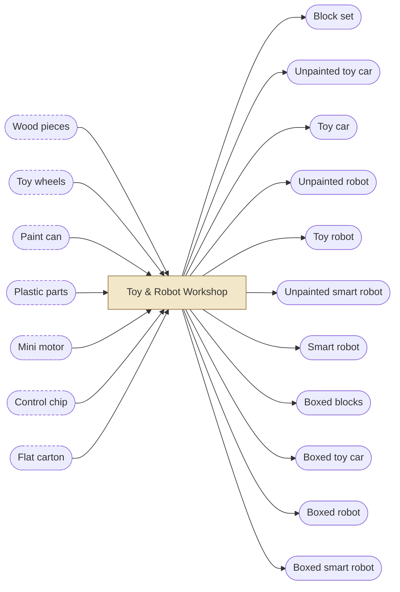
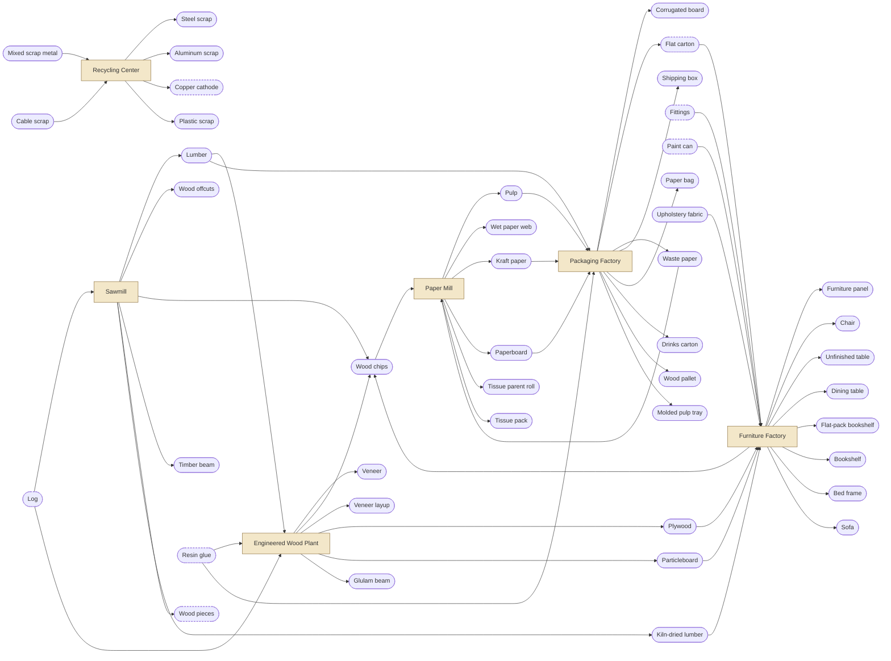
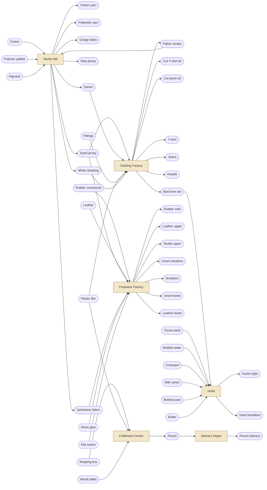

# Content dependency graph

_Generated by `npx tsx tools/gen-content-docs.ts`. Do not edit by hand._

Per-chapter flowcharts show, for every building of that chapter with recipes, the items it takes in from outside and the items it makes (item → building → item). Items with an import source are drawn with a dashed border.

## Chapter 1

## Chapter 2

## Chapter 3

```mermaid
flowchart LR
  classDef imp stroke-dasharray: 4 3
  classDef bld fill:#f3e7c9,stroke:#8a6d3b
  b_grain_mill["Grain Mill"]:::bld
  i_wheat --> b_grain_mill
  i_paper_bag --> b_grain_mill
  b_grain_mill --> i_flour
  b_grain_mill --> i_bran
  b_grain_mill --> i_wholemeal_flour
  b_grain_mill --> i_semolina
  b_grain_mill --> i_flour_bag
  b_industrial_bakery["Industrial Bakery"]:::bld
  i_flour --> b_industrial_bakery
  i_salt --> b_industrial_bakery
  i_wholemeal_flour --> b_industrial_bakery
  i_paper_bag --> b_industrial_bakery
  i_butter --> b_industrial_bakery
  b_industrial_bakery --> i_dough
  b_industrial_bakery --> i_wholemeal_dough
  b_industrial_bakery --> i_bread_loaf
  b_industrial_bakery --> i_wholemeal_loaf
  b_industrial_bakery --> i_sliced_bread
  b_industrial_bakery --> i_croissant
  b_industrial_bakery --> i_pizza_base
  b_pasta_factory["Pasta Factory"]:::bld
  i_semolina --> b_pasta_factory
  i_carton_flat --> b_pasta_factory
  i_young_cheese --> b_pasta_factory
  b_pasta_factory --> i_pasta_dough
  b_pasta_factory --> i_wet_spaghetti
  b_pasta_factory --> i_wet_penne
  b_pasta_factory --> i_spaghetti_pack
  b_pasta_factory --> i_penne_pack
  b_pasta_factory --> i_fresh_ravioli
  b_dairy_plant["Dairy Plant"]:::bld
  i_raw_milk --> b_dairy_plant
  i_liquid_carton --> b_dairy_plant
  i_fruit --> b_dairy_plant
  b_dairy_plant --> i_cream
  b_dairy_plant --> i_skim_milk
  b_dairy_plant --> i_pasteurized_milk
  b_dairy_plant --> i_milk_carton
  b_dairy_plant --> i_butter
  b_dairy_plant --> i_yogurt_base
  b_dairy_plant --> i_yogurt_cup
  b_dairy_plant --> i_milk_powder
  b_cheese_factory["Cheese Factory"]:::bld
  i_pasteurized_milk --> b_cheese_factory
  i_salt --> b_cheese_factory
  b_cheese_factory --> i_curd
  b_cheese_factory --> i_whey
  b_cheese_factory --> i_green_cheese
  b_cheese_factory --> i_young_cheese
  b_cheese_factory --> i_aged_cheese
  b_cheese_factory --> i_mozzarella
  b_beverage_factory["Beverage Factory"]:::bld
  i_fruit --> b_beverage_factory
  i_sugar --> b_beverage_factory
  i_flavor_concentrate --> b_beverage_factory
  i_glass_bottle --> b_beverage_factory
  i_pet_bottle --> b_beverage_factory
  i_beverage_can --> b_beverage_factory
  b_beverage_factory --> i_juice_base
  b_beverage_factory --> i_soda_syrup
  b_beverage_factory --> i_bottled_juice
  b_beverage_factory --> i_bottled_water
  b_beverage_factory --> i_soda_can
  b_canning_factory["Canning Factory"]:::bld
  i_tinplate --> b_canning_factory
  i_vegetables --> b_canning_factory
  i_tomato --> b_canning_factory
  i_fruit --> b_canning_factory
  i_sugar --> b_canning_factory
  i_vegetable_oil --> b_canning_factory
  i_salt --> b_canning_factory
  i_glass_jar --> b_canning_factory
  b_canning_factory --> i_food_can
  b_canning_factory --> i_blanched_veg
  b_canning_factory --> i_canned_tomatoes
  b_canning_factory --> i_canned_vegetables
  b_canning_factory --> i_canned_fruit
  b_canning_factory --> i_pasta_sauce
  b_canning_factory --> i_sauce_jar
  b_frozen_food_factory["Frozen Food Factory"]:::bld
  i_potato --> b_frozen_food_factory
  i_vegetable_oil --> b_frozen_food_factory
  i_pizza_base --> b_frozen_food_factory
  i_mozzarella --> b_frozen_food_factory
  i_pasta_sauce --> b_frozen_food_factory
  i_carton_flat --> b_frozen_food_factory
  i_molded_tray --> b_frozen_food_factory
  i_plastic_film --> b_frozen_food_factory
  i_blanched_veg --> b_frozen_food_factory
  b_frozen_food_factory --> i_par_fried_fries
  b_frozen_food_factory --> i_raw_pizza
  b_frozen_food_factory --> i_frozen_pizza
  b_frozen_food_factory --> i_frozen_fries
  b_frozen_food_factory --> i_frozen_vegetables
  b_chocolate_factory["Chocolate Factory"]:::bld
  i_cocoa_beans --> b_chocolate_factory
  i_sugar --> b_chocolate_factory
  i_milk_powder --> b_chocolate_factory
  i_carton_flat --> b_chocolate_factory
  i_cream --> b_chocolate_factory
  i_molded_tray --> b_chocolate_factory
  b_chocolate_factory --> i_cocoa_mass
  b_chocolate_factory --> i_cocoa_butter
  b_chocolate_factory --> i_dark_chocolate
  b_chocolate_factory --> i_milk_chocolate
  b_chocolate_factory --> i_dark_chocolate_bar
  b_chocolate_factory --> i_milk_chocolate_bar
  b_chocolate_factory --> i_praline_box
  b_snack_factory["Snack Factory"]:::bld
  i_potato --> b_snack_factory
  i_vegetable_oil --> b_snack_factory
  i_salt --> b_snack_factory
  i_whey --> b_snack_factory
  i_plastic_film --> b_snack_factory
  i_flour --> b_snack_factory
  i_carton_flat --> b_snack_factory
  i_bran --> b_snack_factory
  i_sugar --> b_snack_factory
  i_fruit --> b_snack_factory
  b_snack_factory --> i_plain_chips
  b_snack_factory --> i_salted_chips
  b_snack_factory --> i_cheese_chips
  b_snack_factory --> i_chips_salted_bag
  b_snack_factory --> i_chips_cheese_bag
  b_snack_factory --> i_crackers
  b_snack_factory --> i_cracker_box
  b_snack_factory --> i_cereal_bar
  b_cafe["Café"]:::bld
  i_coffee_beans --> b_cafe
  i_milk_carton --> b_cafe
  i_sliced_bread --> b_cafe
  i_young_cheese --> b_cafe
  i_croissant --> b_cafe
  i_yogurt_cup --> b_cafe
  i_frozen_pizza --> b_cafe
  i_spaghetti_pack --> b_cafe
  i_sauce_jar --> b_cafe
  i_aged_cheese --> b_cafe
  b_cafe --> i_coffee_serving
  b_cafe --> i_cafe_meal
  i_wheat(["Wheat"]):::imp
  i_paper_bag(["Paper bag"])
  i_flour(["Flour"])
  i_bran(["Bran"])
  i_wholemeal_flour(["Wholemeal flour"])
  i_semolina(["Semolina"])
  i_flour_bag(["Bag of flour"])
  i_salt(["Salt"]):::imp
  i_butter(["Butter"])
  i_dough(["Dough"])
  i_wholemeal_dough(["Wholemeal dough"])
  i_bread_loaf(["Bread loaf"])
  i_wholemeal_loaf(["Wholemeal loaf"])
  i_sliced_bread(["Sliced bread"])
  i_croissant(["Croissant"])
  i_pizza_base(["Pizza base"])
  i_carton_flat(["Flat carton"]):::imp
  i_young_cheese(["Young cheese"])
  i_pasta_dough(["Pasta dough"])
  i_wet_spaghetti(["Fresh spaghetti"])
  i_wet_penne(["Fresh penne"])
  i_spaghetti_pack(["Spaghetti pack"])
  i_penne_pack(["Penne pack"])
  i_fresh_ravioli(["Fresh ravioli"])
  i_raw_milk(["Raw milk"]):::imp
  i_liquid_carton(["Drinks carton"])
  i_fruit(["Fruit"]):::imp
  i_cream(["Cream"])
  i_skim_milk(["Skim milk"])
  i_pasteurized_milk(["Pasteurized milk"])
  i_milk_carton(["Milk carton"])
  i_yogurt_base(["Yogurt base"])
  i_yogurt_cup(["Yogurt cup"])
  i_milk_powder(["Milk powder"])
  i_curd(["Curd"])
  i_whey(["Whey"])
  i_green_cheese(["Fresh cheese wheel"])
  i_aged_cheese(["Aged cheese"])
  i_mozzarella(["Mozzarella"])
  i_sugar(["Sugar"]):::imp
  i_flavor_concentrate(["Flavor concentrate"]):::imp
  i_glass_bottle(["Glass bottle"]):::imp
  i_pet_bottle(["PET bottle"]):::imp
  i_beverage_can(["Empty drinks can"]):::imp
  i_juice_base(["Juice base"])
  i_soda_syrup(["Soda syrup"])
  i_bottled_juice(["Bottled juice"])
  i_bottled_water(["Bottled water"])
  i_soda_can(["Soda can"])
  i_tinplate(["Tinplate"]):::imp
  i_vegetables(["Vegetables"]):::imp
  i_tomato(["Tomatoes"]):::imp
  i_vegetable_oil(["Vegetable oil"]):::imp
  i_glass_jar(["Glass jar"]):::imp
  i_food_can(["Food can"])
  i_blanched_veg(["Blanched vegetables"])
  i_canned_tomatoes(["Canned tomatoes"])
  i_canned_vegetables(["Canned vegetables"])
  i_canned_fruit(["Canned fruit"])
  i_pasta_sauce(["Pasta sauce"])
  i_sauce_jar(["Jar of sauce"])
  i_potato(["Potatoes"]):::imp
  i_molded_tray(["Molded pulp tray"])
  i_plastic_film(["Plastic film"]):::imp
  i_par_fried_fries(["Par-fried fries"])
  i_raw_pizza(["Unbaked pizza"])
  i_frozen_pizza(["Frozen pizza"])
  i_frozen_fries(["Frozen fries"])
  i_frozen_vegetables(["Frozen vegetables"])
  i_cocoa_beans(["Cocoa beans"]):::imp
  i_cocoa_mass(["Cocoa mass"])
  i_cocoa_butter(["Cocoa butter"])
  i_dark_chocolate(["Dark chocolate"])
  i_milk_chocolate(["Milk chocolate"])
  i_dark_chocolate_bar(["Dark chocolate bar"])
  i_milk_chocolate_bar(["Milk chocolate bar"])
  i_praline_box(["Praline box"])
  i_plain_chips(["Plain chips"])
  i_salted_chips(["Salted chips"])
  i_cheese_chips(["Cheese chips"])
  i_chips_salted_bag(["Salted chips bag"])
  i_chips_cheese_bag(["Cheese chips bag"])
  i_crackers(["Crackers"])
  i_cracker_box(["Box of crackers"])
  i_cereal_bar(["Cereal bar"])
  i_coffee_beans(["Coffee beans"]):::imp
  i_coffee_serving(["Coffee"])
  i_cafe_meal(["Café meal"])
```

## Chapter 4

```mermaid
flowchart LR
  classDef imp stroke-dasharray: 4 3
  classDef bld fill:#f3e7c9,stroke:#8a6d3b
  b_glassworks["Glassworks"]:::bld
  i_sand --> b_glassworks
  i_soda_ash --> b_glassworks
  i_limestone --> b_glassworks
  b_glassworks --> i_glass_batch
  b_glassworks --> i_molten_glass
  b_glassworks --> i_glass_pane
  b_glassworks --> i_cullet
  b_glassworks --> i_hot_bottles
  b_glassworks --> i_hot_jars
  b_glassworks --> i_glass_bottle
  b_glassworks --> i_glass_jar
  b_glassworks --> i_cover_glass
  b_steelworks["Steelworks"]:::bld
  i_iron_ore --> b_steelworks
  i_coke --> b_steelworks
  i_limestone --> b_steelworks
  i_tin_ingot --> b_steelworks
  b_steelworks --> i_pig_iron
  b_steelworks --> i_slag
  b_steelworks --> i_steel_billet
  b_steelworks --> i_steel_sheet
  b_steelworks --> i_steel_scrap
  b_steelworks --> i_steel_wire
  b_steelworks --> i_steel_beam
  b_steelworks --> i_rebar
  b_steelworks --> i_tinplate
  b_aluminum_plant["Aluminum Plant"]:::bld
  i_bauxite --> b_aluminum_plant
  b_aluminum_plant --> i_alumina
  b_aluminum_plant --> i_aluminum_ingot
  b_aluminum_plant --> i_aluminum_sheet
  b_aluminum_plant --> i_aluminum_profile
  b_aluminum_plant --> i_aluminum_scrap
  b_aluminum_plant --> i_beverage_can
  b_concrete_plant["Concrete Plant"]:::bld
  i_limestone --> b_concrete_plant
  i_clay --> b_concrete_plant
  i_slag --> b_concrete_plant
  i_aggregate --> b_concrete_plant
  i_sand --> b_concrete_plant
  i_rebar --> b_concrete_plant
  b_concrete_plant --> i_clinker
  b_concrete_plant --> i_cement
  b_concrete_plant --> i_ready_mix_concrete
  b_concrete_plant --> i_precast_panel
  b_concrete_plant --> i_concrete_block
  b_brick_works["Brick & Tile Works"]:::bld
  i_clay --> b_brick_works
  i_ceramic_glaze --> b_brick_works
  b_brick_works --> i_green_bricks
  b_brick_works --> i_green_tiles
  b_brick_works --> i_brick
  b_brick_works --> i_roof_tile
  b_brick_works --> i_ceramic_tile
  b_construction_company["Construction Company"]:::bld
  i_brick --> b_construction_company
  i_roof_tile --> b_construction_company
  i_glass_pane --> b_construction_company
  i_timber_beam --> b_construction_company
  i_ready_mix_concrete --> b_construction_company
  i_aggregate --> b_construction_company
  i_concrete_block --> b_construction_company
  i_ceramic_tile --> b_construction_company
  i_wall_paint --> b_construction_company
  i_power_cable --> b_construction_company
  i_rebar --> b_construction_company
  i_steel_beam --> b_construction_company
  i_precast_panel --> b_construction_company
  i_solar_panel_premium --> b_construction_company
  i_steel_bracket --> b_construction_company
  i_solar_panel_standard --> b_construction_company
  i_led_streetlight --> b_construction_company
  i_modular_unit --> b_construction_company
  i_site_cabin --> b_construction_company
  i_patient_monitor --> b_construction_company
  i_ultrasound_scanner --> b_construction_company
  i_led_panel_light --> b_construction_company
  b_construction_company --> i_construction_progress
  b_cable_factory["Wire & Cable Factory"]:::bld
  i_copper_cathode --> b_cable_factory
  i_insulating_varnish --> b_cable_factory
  i_pvc_compound --> b_cable_factory
  b_cable_factory --> i_copper_rod
  b_cable_factory --> i_copper_wire
  b_cable_factory --> i_magnet_wire
  b_cable_factory --> i_power_cable
  b_cable_factory --> i_cable_scrap
  b_cable_factory --> i_data_cable
  b_plastics_factory["Plastics Factory"]:::bld
  i_polymer_feedstock --> b_plastics_factory
  i_salt --> b_plastics_factory
  b_plastics_factory --> i_polymer_pellets
  b_plastics_factory --> i_pvc_compound
  b_plastics_factory --> i_plastic_parts
  b_plastics_factory --> i_plastic_scrap
  b_plastics_factory --> i_toy_wheels
  b_plastics_factory --> i_appliance_housing
  b_plastics_factory --> i_plastic_film
  b_plastics_factory --> i_pet_bottle
  b_tire_factory["Tire & Rubber Factory"]:::bld
  i_natural_rubber --> b_tire_factory
  i_carbon_black --> b_tire_factory
  i_steel_wire --> b_tire_factory
  b_tire_factory --> i_rubber_compound
  b_tire_factory --> i_green_car_tire
  b_tire_factory --> i_car_tire
  b_tire_factory --> i_green_bike_tire
  b_tire_factory --> i_bicycle_tire
  b_tire_factory --> i_rubber_gasket
  b_tire_factory --> i_solid_tire
  b_paint_plant["Paint & Coatings Plant"]:::bld
  i_polymer_pellets --> b_paint_plant
  i_pigment --> b_paint_plant
  i_tinplate --> b_paint_plant
  i_sand --> b_paint_plant
  b_paint_plant --> i_binder_resin
  b_paint_plant --> i_resin_glue
  b_paint_plant --> i_base_paint
  b_paint_plant --> i_paint_can
  b_paint_plant --> i_wall_paint
  b_paint_plant --> i_insulating_varnish
  b_paint_plant --> i_ceramic_glaze
  b_paint_plant --> i_powder_coating
  b_precision_parts_factory["Precision Parts Factory"]:::bld
  i_steel_billet --> b_precision_parts_factory
  i_steel_sheet --> b_precision_parts_factory
  b_precision_parts_factory --> i_machined_shaft
  b_precision_parts_factory --> i_steel_scrap
  b_precision_parts_factory --> i_gear_set
  b_precision_parts_factory --> i_bearing
  b_precision_parts_factory --> i_furniture_fittings
  b_precision_parts_factory --> i_steel_bracket
  b_precision_parts_factory --> i_precision_gearbox
  b_motor_factory["Electric Motor Factory"]:::bld
  i_magnet_wire --> b_motor_factory
  i_steel_sheet --> b_motor_factory
  i_machined_shaft --> b_motor_factory
  i_plastic_parts --> b_motor_factory
  i_bearing --> b_motor_factory
  i_rare_earth_magnet --> b_motor_factory
  b_motor_factory --> i_stator
  b_motor_factory --> i_rotor
  b_motor_factory --> i_mini_motor
  b_motor_factory --> i_industrial_motor_raw
  b_motor_factory --> i_industrial_motor
  b_motor_factory --> i_bldc_motor
  b_motor_factory --> i_traction_motor_raw
  b_motor_factory --> i_traction_motor
  i_sand(["Sand"]):::imp
  i_soda_ash(["Soda ash"]):::imp
  i_limestone(["Limestone"]):::imp
  i_glass_batch(["Glass batch"])
  i_molten_glass(["Molten glass"])
  i_glass_pane(["Glass pane"])
  i_cullet(["Cullet"])
  i_hot_bottles(["Hot bottles"])
  i_hot_jars(["Hot jars"])
  i_glass_bottle(["Glass bottle"]):::imp
  i_glass_jar(["Glass jar"]):::imp
  i_cover_glass(["Cover glass"])
  i_iron_ore(["Iron ore"]):::imp
  i_coke(["Coke"]):::imp
  i_tin_ingot(["Tin ingot"]):::imp
  i_pig_iron(["Pig iron"])
  i_slag(["Slag"])
  i_steel_billet(["Steel billet"])
  i_steel_sheet(["Steel sheet"])
  i_steel_scrap(["Steel scrap"])
  i_steel_wire(["Steel wire"])
  i_steel_beam(["Steel beam"])
  i_rebar(["Rebar"])
  i_tinplate(["Tinplate"]):::imp
  i_bauxite(["Bauxite"]):::imp
  i_alumina(["Alumina"])
  i_aluminum_ingot(["Aluminum ingot"])
  i_aluminum_sheet(["Aluminum sheet"])
  i_aluminum_profile(["Aluminum profile"])
  i_aluminum_scrap(["Aluminum scrap"])
  i_beverage_can(["Empty drinks can"]):::imp
  i_clay(["Clay"]):::imp
  i_aggregate(["Aggregate"]):::imp
  i_clinker(["Clinker"])
  i_cement(["Cement"])
  i_ready_mix_concrete(["Ready-mix concrete"])
  i_precast_panel(["Precast panel"])
  i_concrete_block(["Concrete block"])
  i_ceramic_glaze(["Ceramic glaze"])
  i_green_bricks(["Unfired bricks"])
  i_green_tiles(["Unfired tiles"])
  i_brick(["Brick"])
  i_roof_tile(["Roof tile"])
  i_ceramic_tile(["Ceramic tile"])
  i_timber_beam(["Timber beam"])
  i_wall_paint(["Wall paint"])
  i_power_cable(["Power cable"])
  i_solar_panel_premium(["Premium solar panel"])
  i_steel_bracket(["Steel bracket"])
  i_solar_panel_standard(["Standard solar panel"])
  i_led_streetlight(["LED streetlight"])
  i_modular_unit(["Modular room unit"])
  i_site_cabin(["Site cabin"])
  i_patient_monitor(["Diagnostic monitor"])
  i_ultrasound_scanner(["Ultrasound scanner"])
  i_led_panel_light(["LED panel light"])
  i_construction_progress(["Construction progress"])
  i_copper_cathode(["Copper cathode"]):::imp
  i_insulating_varnish(["Insulating varnish"])
  i_pvc_compound(["PVC compound"])
  i_copper_rod(["Copper rod"])
  i_copper_wire(["Copper wire"])
  i_magnet_wire(["Magnet wire"])
  i_cable_scrap(["Cable scrap"])
  i_data_cable(["Data cable"])
  i_polymer_feedstock(["Polymer feedstock"]):::imp
  i_salt(["Salt"]):::imp
  i_polymer_pellets(["Polymer pellets"])
  i_plastic_parts(["Plastic parts"]):::imp
  i_plastic_scrap(["Plastic scrap"])
  i_toy_wheels(["Toy wheels"]):::imp
  i_appliance_housing(["Plastic housing"])
  i_plastic_film(["Plastic film"]):::imp
  i_pet_bottle(["PET bottle"]):::imp
  i_natural_rubber(["Natural rubber"]):::imp
  i_carbon_black(["Carbon black"]):::imp
  i_rubber_compound(["Rubber compound"])
  i_green_car_tire(["Uncured car tire"])
  i_car_tire(["Car tire"])
  i_green_bike_tire(["Uncured bike tire"])
  i_bicycle_tire(["Bicycle tire"])
  i_rubber_gasket(["Rubber gasket"])
  i_solid_tire(["Solid tire"])
  i_pigment(["Pigment"]):::imp
  i_binder_resin(["Binder resin"])
  i_resin_glue(["Resin glue"]):::imp
  i_base_paint(["Base paint"])
  i_paint_can(["Paint can"]):::imp
  i_powder_coating(["Powder coating"])
  i_machined_shaft(["Machined shaft"])
  i_gear_set(["Gear set"])
  i_bearing(["Bearing"])
  i_furniture_fittings(["Fittings"]):::imp
  i_precision_gearbox(["Precision gearbox"])
  i_rare_earth_magnet(["Rare-earth magnet"]):::imp
  i_stator(["Stator"])
  i_rotor(["Rotor"])
  i_mini_motor(["Mini motor"]):::imp
  i_industrial_motor_raw(["Untested motor"])
  i_industrial_motor(["Industrial motor"])
  i_bldc_motor(["Brushless motor"])
  i_traction_motor_raw(["Untested traction motor"])
  i_traction_motor(["Traction motor"])
```

## Chapter 5

## Chapter 6

```mermaid
flowchart LR
  classDef imp stroke-dasharray: 4 3
  classDef bld fill:#f3e7c9,stroke:#8a6d3b
  b_pcb_factory["Circuit Board Factory"]:::bld
  i_binder_resin --> b_pcb_factory
  i_copper_cathode --> b_pcb_factory
  i_logic_chip --> b_pcb_factory
  i_power_chip --> b_pcb_factory
  i_memory_chip --> b_pcb_factory
  i_sensor_chip --> b_pcb_factory
  b_pcb_factory --> i_pcb_laminate
  b_pcb_factory --> i_bare_pcb
  b_pcb_factory --> i_control_chip
  b_pcb_factory --> i_controller_board
  b_pcb_factory --> i_populated_mainboard
  b_pcb_factory --> i_mainboard
  b_pcb_factory --> i_populated_phone_board
  b_pcb_factory --> i_phone_board
  b_semiconductor_plant["Semiconductor Plant"]:::bld
  i_silicon_wafer --> b_semiconductor_plant
  i_specialty_gas --> b_semiconductor_plant
  b_semiconductor_plant --> i_logic_wafer
  b_semiconductor_plant --> i_memory_wafer
  b_semiconductor_plant --> i_power_wafer
  b_semiconductor_plant --> i_sensor_wafer
  b_semiconductor_plant --> i_logic_chip
  b_semiconductor_plant --> i_memory_chip
  b_semiconductor_plant --> i_power_chip
  b_semiconductor_plant --> i_sensor_chip
  b_battery_factory["Battery Factory"]:::bld
  i_lithium_salt --> b_battery_factory
  i_aluminum_sheet --> b_battery_factory
  i_binder_resin --> b_battery_factory
  i_graphite --> b_battery_factory
  i_copper_cathode --> b_battery_factory
  i_power_chip --> b_battery_factory
  i_plastic_parts --> b_battery_factory
  i_carton_flat --> b_battery_factory
  i_controller_board --> b_battery_factory
  i_aluminum_profile --> b_battery_factory
  b_battery_factory --> i_cathode_sheet
  b_battery_factory --> i_anode_sheet
  b_battery_factory --> i_unformed_cell
  b_battery_factory --> i_formed_cell
  b_battery_factory --> i_battery_cell
  b_battery_factory --> i_battery_cell_b
  b_battery_factory --> i_battery_pack
  b_battery_factory --> i_power_bank
  b_battery_factory --> i_ev_battery_module
  b_computer_factory["Computer Factory"]:::bld
  i_aluminum_sheet --> b_computer_factory
  i_mainboard --> b_computer_factory
  i_display_panel --> b_computer_factory
  i_battery_pack --> b_computer_factory
  i_appliance_housing --> b_computer_factory
  i_carton_flat --> b_computer_factory
  i_memory_chip --> b_computer_factory
  i_power_chip --> b_computer_factory
  i_steel_sheet --> b_computer_factory
  i_shipping_box --> b_computer_factory
  b_computer_factory --> i_laptop_chassis
  b_computer_factory --> i_aluminum_scrap
  b_computer_factory --> i_budget_laptop_unit
  b_computer_factory --> i_budget_laptop
  b_computer_factory --> i_pro_laptop_unit
  b_computer_factory --> i_pro_laptop
  b_computer_factory --> i_desktop_pc
  b_smartphone_factory["Smartphone Factory"]:::bld
  i_aluminum_sheet --> b_smartphone_factory
  i_display_panel --> b_smartphone_factory
  i_cover_glass --> b_smartphone_factory
  i_phone_board --> b_smartphone_factory
  i_battery_cell --> b_smartphone_factory
  i_plastic_parts --> b_smartphone_factory
  i_camera_module --> b_smartphone_factory
  i_memory_chip --> b_smartphone_factory
  i_carton_flat --> b_smartphone_factory
  b_smartphone_factory --> i_phone_housing
  b_smartphone_factory --> i_aluminum_scrap
  b_smartphone_factory --> i_screen_assembly
  b_smartphone_factory --> i_basic_phone_unit
  b_smartphone_factory --> i_pro_phone_unit
  b_smartphone_factory --> i_smartphone_basic
  b_smartphone_factory --> i_smartphone_pro
  b_wearables_factory["Wearables Factory"]:::bld
  i_rubber_compound --> b_wearables_factory
  i_controller_board --> b_wearables_factory
  i_mems_sensor --> b_wearables_factory
  i_battery_cell_b --> b_wearables_factory
  i_carton_flat --> b_wearables_factory
  i_logic_chip --> b_wearables_factory
  i_memory_chip --> b_wearables_factory
  i_battery_cell --> b_wearables_factory
  i_screen_assembly --> b_wearables_factory
  i_cover_glass --> b_wearables_factory
  b_wearables_factory --> i_watch_strap
  b_wearables_factory --> i_fitness_band
  b_wearables_factory --> i_watch_core
  b_wearables_factory --> i_smartwatch
  b_audio_factory["Audio Equipment Factory"]:::bld
  i_magnet_wire --> b_audio_factory
  i_rare_earth_magnet --> b_audio_factory
  i_kraft_paper --> b_audio_factory
  i_plywood --> b_audio_factory
  i_battery_cell_b --> b_audio_factory
  i_controller_board --> b_audio_factory
  i_plastic_parts --> b_audio_factory
  i_carton_flat --> b_audio_factory
  i_battery_cell --> b_audio_factory
  i_appliance_housing --> b_audio_factory
  i_copper_wire --> b_audio_factory
  i_shipping_box --> b_audio_factory
  b_audio_factory --> i_speaker_driver
  b_audio_factory --> i_speaker_cabinet
  b_audio_factory --> i_wireless_earbuds
  b_audio_factory --> i_bluetooth_speaker
  b_audio_factory --> i_hifi_speaker_pair
  b_appliance_factory["Home Appliance Factory"]:::bld
  i_steel_sheet --> b_appliance_factory
  i_steel_bracket --> b_appliance_factory
  i_powder_coating --> b_appliance_factory
  i_industrial_motor --> b_appliance_factory
  i_copper_wire --> b_appliance_factory
  i_rubber_gasket --> b_appliance_factory
  i_controller_board --> b_appliance_factory
  i_plastic_parts --> b_appliance_factory
  i_shipping_box --> b_appliance_factory
  i_wood_pallet --> b_appliance_factory
  i_glass_pane --> b_appliance_factory
  i_power_chip --> b_appliance_factory
  i_cover_glass --> b_appliance_factory
  b_appliance_factory --> i_appliance_cabinet_raw
  b_appliance_factory --> i_appliance_cabinet
  b_appliance_factory --> i_fridge_unit
  b_appliance_factory --> i_fridge
  b_appliance_factory --> i_washer_unit
  b_appliance_factory --> i_washing_machine
  b_appliance_factory --> i_microwave
  b_camera_factory["Camera Factory"]:::bld
  i_lens_blank --> b_camera_factory
  i_sensor_chip --> b_camera_factory
  i_bare_pcb --> b_camera_factory
  i_logic_chip --> b_camera_factory
  i_battery_pack --> b_camera_factory
  i_aluminum_sheet --> b_camera_factory
  i_carton_flat --> b_camera_factory
  i_controller_board --> b_camera_factory
  i_appliance_housing --> b_camera_factory
  i_data_cable --> b_camera_factory
  b_camera_factory --> i_lens_assembly
  b_camera_factory --> i_camera_module_raw
  b_camera_factory --> i_camera_module
  b_camera_factory --> i_digital_camera
  b_camera_factory --> i_security_camera
  b_network_factory["Network Hardware Factory"]:::bld
  i_controller_board --> b_network_factory
  i_logic_chip --> b_network_factory
  i_appliance_housing --> b_network_factory
  i_power_chip --> b_network_factory
  i_carton_flat --> b_network_factory
  i_mainboard --> b_network_factory
  i_steel_sheet --> b_network_factory
  i_data_cable --> b_network_factory
  i_shipping_box --> b_network_factory
  b_network_factory --> i_router_unit
  b_network_factory --> i_home_router
  b_network_factory --> i_switch_unit
  b_network_factory --> i_network_switch
  i_binder_resin(["Binder resin"])
  i_copper_cathode(["Copper cathode"]):::imp
  i_logic_chip(["Logic chip"]):::imp
  i_power_chip(["Power chip"]):::imp
  i_memory_chip(["Memory chip"]):::imp
  i_sensor_chip(["Sensor chip"]):::imp
  i_pcb_laminate(["PCB laminate"])
  i_bare_pcb(["Bare circuit board"])
  i_control_chip(["Control chip"]):::imp
  i_controller_board(["Controller board"])
  i_populated_mainboard(["Uninspected mainboard"])
  i_mainboard(["Mainboard"])
  i_populated_phone_board(["Uninspected phone board"])
  i_phone_board(["Phone board"])
  i_silicon_wafer(["Silicon wafer"]):::imp
  i_specialty_gas(["Specialty gas"]):::imp
  i_logic_wafer(["Logic wafer"])
  i_memory_wafer(["Memory wafer"])
  i_power_wafer(["Power wafer"])
  i_sensor_wafer(["Sensor wafer"])
  i_lithium_salt(["Lithium salt"]):::imp
  i_aluminum_sheet(["Aluminum sheet"])
  i_graphite(["Graphite"]):::imp
  i_plastic_parts(["Plastic parts"]):::imp
  i_carton_flat(["Flat carton"]):::imp
  i_aluminum_profile(["Aluminum profile"])
  i_cathode_sheet(["Cathode sheet"])
  i_anode_sheet(["Anode sheet"])
  i_unformed_cell(["Raw battery cell"])
  i_formed_cell(["Formed cell"])
  i_battery_cell(["Battery cell (A)"])
  i_battery_cell_b(["Battery cell (B)"])
  i_battery_pack(["Battery pack"])
  i_power_bank(["Power bank"])
  i_ev_battery_module(["EV battery module"])
  i_display_panel(["Display panel"]):::imp
  i_appliance_housing(["Plastic housing"])
  i_steel_sheet(["Steel sheet"])
  i_shipping_box(["Shipping box"])
  i_laptop_chassis(["Laptop chassis"])
  i_aluminum_scrap(["Aluminum scrap"])
  i_budget_laptop_unit(["Untested budget laptop"])
  i_budget_laptop(["Budget laptop"])
  i_pro_laptop_unit(["Untested pro laptop"])
  i_pro_laptop(["Pro laptop"])
  i_desktop_pc(["Desktop PC"])
  i_cover_glass(["Cover glass"])
  i_camera_module(["Camera module"])
  i_phone_housing(["Phone housing"])
  i_screen_assembly(["Screen assembly"])
  i_basic_phone_unit(["Untested basic phone"])
  i_pro_phone_unit(["Untested pro phone"])
  i_smartphone_basic(["Basic smartphone"])
  i_smartphone_pro(["Pro smartphone"])
  i_rubber_compound(["Rubber compound"])
  i_mems_sensor(["MEMS sensor"]):::imp
  i_watch_strap(["Watch strap"])
  i_fitness_band(["Fitness band"])
  i_watch_core(["Watch core"])
  i_smartwatch(["Smartwatch"])
  i_magnet_wire(["Magnet wire"])
  i_rare_earth_magnet(["Rare-earth magnet"]):::imp
  i_kraft_paper(["Kraft paper"])
  i_plywood(["Plywood"])
  i_copper_wire(["Copper wire"])
  i_speaker_driver(["Speaker driver"])
  i_speaker_cabinet(["Speaker cabinet"])
  i_wireless_earbuds(["Wireless earbuds"])
  i_bluetooth_speaker(["Bluetooth speaker"])
  i_hifi_speaker_pair(["Hi-fi speaker pair"])
  i_steel_bracket(["Steel bracket"])
  i_powder_coating(["Powder coating"])
  i_industrial_motor(["Industrial motor"])
  i_rubber_gasket(["Rubber gasket"])
  i_wood_pallet(["Wood pallet"])
  i_glass_pane(["Glass pane"])
  i_appliance_cabinet_raw(["Raw appliance cabinet"])
  i_appliance_cabinet(["Coated cabinet"])
  i_fridge_unit(["Untested fridge"])
  i_fridge(["Fridge"])
  i_washer_unit(["Untested washer"])
  i_washing_machine(["Washing machine"])
  i_microwave(["Microwave"])
  i_lens_blank(["Lens blank"]):::imp
  i_data_cable(["Data cable"])
  i_lens_assembly(["Lens assembly"])
  i_camera_module_raw(["Camera module (raw)"])
  i_digital_camera(["Digital camera"])
  i_security_camera(["Security camera"])
  i_router_unit(["Untested router"])
  i_home_router(["Home router"])
  i_switch_unit(["Unconfigured switch"])
  i_network_switch(["Network switch"])
```

## Chapter 7

```mermaid
flowchart LR
  classDef imp stroke-dasharray: 4 3
  classDef bld fill:#f3e7c9,stroke:#8a6d3b
  b_robotics_factory["Industrial Robot Plant"]:::bld
  i_bldc_motor --> b_robotics_factory
  i_precision_gearbox --> b_robotics_factory
  i_sensor_chip --> b_robotics_factory
  i_mainboard --> b_robotics_factory
  i_power_chip --> b_robotics_factory
  i_steel_sheet --> b_robotics_factory
  i_mems_sensor --> b_robotics_factory
  i_plastic_parts --> b_robotics_factory
  i_steel_bracket --> b_robotics_factory
  i_aluminum_profile --> b_robotics_factory
  i_power_cable --> b_robotics_factory
  i_wood_pallet --> b_robotics_factory
  b_robotics_factory --> i_servo_actuator
  b_robotics_factory --> i_robot_controller
  b_robotics_factory --> i_gripper_module
  b_robotics_factory --> i_palletizer_head
  b_robotics_factory --> i_arm_frame
  b_robotics_factory --> i_robot_arm_uncal
  b_robotics_factory --> i_picking_robot
  b_robotics_factory --> i_palletizing_robot
  b_drone_factory["Drone Factory"]:::bld
  i_aluminum_profile --> b_drone_factory
  i_plastic_parts --> b_drone_factory
  i_controller_board --> b_drone_factory
  i_mems_sensor --> b_drone_factory
  i_bldc_motor --> b_drone_factory
  i_battery_pack --> b_drone_factory
  i_camera_module --> b_drone_factory
  i_carton_flat --> b_drone_factory
  b_drone_factory --> i_drone_frame
  b_drone_factory --> i_flight_controller
  b_drone_factory --> i_camera_drone_unit
  b_drone_factory --> i_camera_drone
  b_drone_factory --> i_delivery_drone_unit
  b_drone_factory --> i_delivery_drone
  b_bicycle_factory["Bicycle Factory"]:::bld
  i_aluminum_profile --> b_bicycle_factory
  i_powder_coating --> b_bicycle_factory
  i_bicycle_tire --> b_bicycle_factory
  i_steel_wire --> b_bicycle_factory
  i_gear_set --> b_bicycle_factory
  i_shipping_box --> b_bicycle_factory
  i_machined_shaft --> b_bicycle_factory
  i_bearing --> b_bicycle_factory
  i_bldc_motor --> b_bicycle_factory
  i_battery_pack --> b_bicycle_factory
  b_bicycle_factory --> i_raw_bike_frame
  b_bicycle_factory --> i_aluminum_scrap
  b_bicycle_factory --> i_bike_frame
  b_bicycle_factory --> i_wheelset
  b_bicycle_factory --> i_drivetrain_kit
  b_bicycle_factory --> i_city_bicycle
  b_bicycle_factory --> i_mountain_bike
  b_bicycle_factory --> i_cargo_ebike
  b_escooter_factory["E-Scooter Factory"]:::bld
  i_aluminum_profile --> b_escooter_factory
  i_bldc_motor --> b_escooter_factory
  i_rubber_compound --> b_escooter_factory
  i_battery_pack --> b_escooter_factory
  i_controller_board --> b_escooter_factory
  i_shipping_box --> b_escooter_factory
  b_escooter_factory --> i_scooter_deck
  b_escooter_factory --> i_aluminum_scrap
  b_escooter_factory --> i_hub_motor_wheel
  b_escooter_factory --> i_scooter_unit
  b_escooter_factory --> i_e_scooter
  b_escooter_factory --> i_lr_scooter_unit
  b_escooter_factory --> i_e_scooter_lr
  b_ev_factory["Electric Vehicle Factory"]:::bld
  i_steel_sheet --> b_ev_factory
  i_steel_beam --> b_ev_factory
  i_aluminum_profile --> b_ev_factory
  i_paint_can --> b_ev_factory
  i_powder_coating --> b_ev_factory
  i_ev_battery_module --> b_ev_factory
  i_traction_motor --> b_ev_factory
  i_car_tire --> b_ev_factory
  i_controller_board --> b_ev_factory
  i_glass_pane --> b_ev_factory
  i_display_panel --> b_ev_factory
  i_upholstery_fabric --> b_ev_factory
  i_power_cable --> b_ev_factory
  b_ev_factory --> i_body_panels
  b_ev_factory --> i_steel_scrap
  b_ev_factory --> i_body_in_white
  b_ev_factory --> i_painted_body
  b_ev_factory --> i_ev_chassis
  b_ev_factory --> i_electric_car
  b_ev_factory --> i_electric_van
  b_forklift_factory["Forklift Factory"]:::bld
  i_steel_beam --> b_forklift_factory
  i_steel_wire --> b_forklift_factory
  i_steel_scrap --> b_forklift_factory
  i_industrial_motor --> b_forklift_factory
  i_battery_pack --> b_forklift_factory
  i_solid_tire --> b_forklift_factory
  i_controller_board --> b_forklift_factory
  i_sensor_chip --> b_forklift_factory
  b_forklift_factory --> i_mast_assembly
  b_forklift_factory --> i_counterweight
  b_forklift_factory --> i_forklift_unit
  b_forklift_factory --> i_forklift
  b_forklift_factory --> i_reach_truck_unit
  b_forklift_factory --> i_reach_truck
  b_solar_factory["Solar Panel Factory"]:::bld
  i_solar_wafer --> b_solar_factory
  i_copper_wire --> b_solar_factory
  i_cover_glass --> b_solar_factory
  i_plastic_film --> b_solar_factory
  i_aluminum_profile --> b_solar_factory
  b_solar_factory --> i_raw_solar_cells
  b_solar_factory --> i_solar_cell_a
  b_solar_factory --> i_solar_cell_b
  b_solar_factory --> i_cell_string_a
  b_solar_factory --> i_cell_string_b
  b_solar_factory --> i_solar_panel_premium
  b_solar_factory --> i_solar_panel_standard
  b_led_factory["LED Lighting Factory"]:::bld
  i_solar_wafer --> b_led_factory
  i_specialty_gas --> b_led_factory
  i_bare_pcb --> b_led_factory
  i_plastic_parts --> b_led_factory
  i_carton_flat --> b_led_factory
  i_aluminum_profile --> b_led_factory
  i_power_chip --> b_led_factory
  i_cover_glass --> b_led_factory
  b_led_factory --> i_led_die
  b_led_factory --> i_led_high_bin
  b_led_factory --> i_led_low_bin
  b_led_factory --> i_led_bulb
  b_led_factory --> i_led_panel_light
  b_led_factory --> i_led_streetlight
  b_medical_factory["Medical Device Factory"]:::bld
  i_mainboard --> b_medical_factory
  i_display_panel --> b_medical_factory
  i_sensor_chip --> b_medical_factory
  i_appliance_housing --> b_medical_factory
  i_data_cable --> b_medical_factory
  i_plastic_parts --> b_medical_factory
  i_steel_sheet --> b_medical_factory
  i_power_cable --> b_medical_factory
  i_shipping_box --> b_medical_factory
  i_wood_pallet --> b_medical_factory
  b_medical_factory --> i_monitor_unit
  b_medical_factory --> i_ultrasound_probe
  b_medical_factory --> i_ultrasound_unit
  b_medical_factory --> i_patient_monitor
  b_medical_factory --> i_ultrasound_scanner
  b_modular_factory["Modular Building Factory"]:::bld
  i_glulam_beam --> b_modular_factory
  i_plywood --> b_modular_factory
  i_glass_pane --> b_modular_factory
  i_wall_paint --> b_modular_factory
  i_steel_beam --> b_modular_factory
  i_particleboard --> b_modular_factory
  i_ceramic_tile --> b_modular_factory
  i_power_cable --> b_modular_factory
  i_plastic_parts --> b_modular_factory
  i_led_panel_light --> b_modular_factory
  b_modular_factory --> i_wall_module
  b_modular_factory --> i_floor_cassette
  b_modular_factory --> i_bathroom_pod
  b_modular_factory --> i_modular_unit
  b_modular_factory --> i_site_cabin
  i_bldc_motor(["Brushless motor"])
  i_precision_gearbox(["Precision gearbox"])
  i_sensor_chip(["Sensor chip"]):::imp
  i_mainboard(["Mainboard"])
  i_power_chip(["Power chip"]):::imp
  i_steel_sheet(["Steel sheet"])
  i_mems_sensor(["MEMS sensor"]):::imp
  i_plastic_parts(["Plastic parts"]):::imp
  i_steel_bracket(["Steel bracket"])
  i_aluminum_profile(["Aluminum profile"])
  i_power_cable(["Power cable"])
  i_wood_pallet(["Wood pallet"])
  i_servo_actuator(["Servo actuator"])
  i_robot_controller(["Robot controller"])
  i_gripper_module(["Gripper module"])
  i_palletizer_head(["Palletizer head"])
  i_arm_frame(["Robot arm frame"])
  i_robot_arm_uncal(["Uncalibrated robot arm"])
  i_picking_robot(["Picking robot"])
  i_palletizing_robot(["Palletizing robot"])
  i_controller_board(["Controller board"])
  i_battery_pack(["Battery pack"])
  i_camera_module(["Camera module"])
  i_carton_flat(["Flat carton"]):::imp
  i_drone_frame(["Drone frame"])
  i_flight_controller(["Flight controller"])
  i_camera_drone_unit(["Untested camera drone"])
  i_camera_drone(["Camera drone"])
  i_delivery_drone_unit(["Untested delivery drone"])
  i_delivery_drone(["Delivery drone"])
  i_powder_coating(["Powder coating"])
  i_bicycle_tire(["Bicycle tire"])
  i_steel_wire(["Steel wire"])
  i_gear_set(["Gear set"])
  i_shipping_box(["Shipping box"])
  i_machined_shaft(["Machined shaft"])
  i_bearing(["Bearing"])
  i_raw_bike_frame(["Raw bike frame"])
  i_aluminum_scrap(["Aluminum scrap"])
  i_bike_frame(["Bike frame"])
  i_wheelset(["Wheelset"])
  i_drivetrain_kit(["Drivetrain kit"])
  i_city_bicycle(["City bicycle"])
  i_mountain_bike(["Mountain bike"])
  i_cargo_ebike(["Cargo e-bike"])
  i_rubber_compound(["Rubber compound"])
  i_scooter_deck(["Scooter deck"])
  i_hub_motor_wheel(["Hub-motor wheel"])
  i_scooter_unit(["Untested scooter"])
  i_e_scooter(["E-scooter"])
  i_lr_scooter_unit(["Untested LR scooter"])
  i_e_scooter_lr(["Long-range e-scooter"])
  i_steel_beam(["Steel beam"])
  i_paint_can(["Paint can"]):::imp
  i_ev_battery_module(["EV battery module"])
  i_traction_motor(["Traction motor"])
  i_car_tire(["Car tire"])
  i_glass_pane(["Glass pane"])
  i_display_panel(["Display panel"]):::imp
  i_upholstery_fabric(["Upholstery fabric"])
  i_body_panels(["Body panels"])
  i_steel_scrap(["Steel scrap"])
  i_body_in_white(["Body in white"])
  i_painted_body(["Painted body"])
  i_ev_chassis(["EV chassis"])
  i_electric_car(["Electric car"])
  i_electric_van(["Electric van"])
  i_industrial_motor(["Industrial motor"])
  i_solid_tire(["Solid tire"])
  i_mast_assembly(["Mast assembly"])
  i_counterweight(["Counterweight"])
  i_forklift_unit(["Untested forklift"])
  i_forklift(["Forklift"])
  i_reach_truck_unit(["Untested reach truck"])
  i_reach_truck(["Reach truck"])
  i_solar_wafer(["Solar wafer"]):::imp
  i_copper_wire(["Copper wire"])
  i_cover_glass(["Cover glass"])
  i_plastic_film(["Plastic film"]):::imp
  i_raw_solar_cells(["Raw solar cells"])
  i_solar_cell_a(["Solar cell (A)"])
  i_solar_cell_b(["Solar cell (B)"])
  i_cell_string_a(["Premium cell string"])
  i_cell_string_b(["Standard cell string"])
  i_solar_panel_premium(["Premium solar panel"])
  i_solar_panel_standard(["Standard solar panel"])
  i_specialty_gas(["Specialty gas"]):::imp
  i_bare_pcb(["Bare circuit board"])
  i_led_die(["LED die"])
  i_led_high_bin(["High-bin LED"])
  i_led_low_bin(["Low-bin LED"])
  i_led_bulb(["LED bulb"])
  i_led_panel_light(["LED panel light"])
  i_led_streetlight(["LED streetlight"])
  i_appliance_housing(["Plastic housing"])
  i_data_cable(["Data cable"])
  i_monitor_unit(["Untested monitor"])
  i_ultrasound_probe(["Ultrasound probe"])
  i_ultrasound_unit(["Untested scanner"])
  i_patient_monitor(["Diagnostic monitor"])
  i_ultrasound_scanner(["Ultrasound scanner"])
  i_glulam_beam(["Glulam beam"])
  i_plywood(["Plywood"])
  i_wall_paint(["Wall paint"])
  i_particleboard(["Particleboard"])
  i_ceramic_tile(["Ceramic tile"])
  i_wall_module(["Wall module"])
  i_floor_cassette(["Floor cassette"])
  i_bathroom_pod(["Bathroom pod"])
  i_modular_unit(["Modular room unit"])
  i_site_cabin(["Site cabin"])
```

## Item table

| Item | Name | Category | First ch | Producers (recipe @ building) | Consumers | Sources |
|---|---|---|---|---|---|---|
| `wood_pieces` | Wood pieces | component | 1 | chop_offcuts @ sawmill | make_block_set, make_toy_car_raw | import 60¢ |
| `toy_wheels` | Toy wheels | component | 1 | mold_toy_wheels @ plastics_factory | make_toy_car_raw | import 80¢ |
| `paint_can` | Paint can | component | 1 | fill_paint_cans @ paint_plant | paint_toy_car, paint_robot, paint_smart_robot, finish_table, paint_car_body | import 40¢ |
| `carton_flat` | Flat carton | packaging | 1 | die_cut_carton @ packaging_factory | pack_blocks, pack_car, pack_robot, pack_smart_robot, pack_bookshelf_kit, dry_pack_spaghetti, dry_pack_penne, freeze_pizza, mold_dark_bars, mold_milk_bars, decorate_pralines, box_crackers, cure_sneakers, cure_boots, assemble_power_bank, test_budget_laptop, test_pro_laptop, test_basic_phone, test_pro_phone, assemble_fitness_band, finish_smartwatch, tune_earbuds, tune_bt_speaker, build_digital_camera, burn_in_routers, flight_test_camera_drone, assemble_led_bulb | import 25¢ |
| `plastic_parts` | Plastic parts | component | 1 | mold_plastic_parts @ plastics_factory | make_robot_raw, make_smart_robot_raw, assemble_mini_motors, assemble_battery_pack, assemble_power_bank, assemble_basic_phone, tune_earbuds, assemble_fridge, make_gripper_module, build_drone_frame, assemble_led_bulb, build_ultrasound_probe, fit_bathroom_pod | import 90¢ |
| `mini_motor` | Mini motor | component | 1 | assemble_mini_motors @ motor_factory | make_robot_raw, make_smart_robot_raw | import 350¢ |
| `control_chip` | Control chip | component | 1 | assemble_control_chip @ pcb_factory | make_smart_robot_raw | import 600¢ |
| `block_set` | Block set | product | 1 | make_block_set @ toy_workshop | pack_blocks | — |
| `toy_car_raw` | Unpainted toy car | component | 1 | make_toy_car_raw @ toy_workshop | paint_toy_car | — |
| `toy_car` | Toy car | product | 1 | paint_toy_car @ toy_workshop | pack_car | — |
| `robot_raw` | Unpainted robot | component | 1 | make_robot_raw @ toy_workshop | paint_robot | — |
| `toy_robot` | Toy robot | product | 1 | paint_robot @ toy_workshop | pack_robot | — |
| `smart_robot_raw` | Unpainted smart robot | component | 1 | make_smart_robot_raw @ toy_workshop | paint_smart_robot | — |
| `smart_robot` | Smart robot | product | 1 | paint_smart_robot @ toy_workshop | pack_smart_robot | — |
| `boxed_blocks` | Boxed blocks | packaged | 1 | pack_blocks @ toy_workshop | sold by toy_store, resident demand | — |
| `boxed_car` | Boxed toy car | packaged | 1 | pack_car @ toy_workshop | sold by toy_store, resident demand | — |
| `boxed_robot` | Boxed robot | packaged | 1 | pack_robot @ toy_workshop | sold by toy_store, resident demand | — |
| `boxed_smart_robot` | Boxed smart robot | packaged | 1 | pack_smart_robot @ toy_workshop | sold by toy_store, resident demand | — |
| `log` | Log | raw | 2 | — | saw_lumber_yield, saw_beam_layout, peel_veneer | forest 25¢ (tree_farm), import 60¢ |
| `wheat` | Wheat | raw | 3 | — | mill_white, mill_wholemeal, mill_semolina | farm 4¢ (grain_farm), import 10¢ |
| `raw_milk` | Raw milk | raw | 3 | — | separate_milk, pasteurize_milk | farm 5¢ (dairy_farm), import 13¢ |
| `fruit` | Fruit | raw | 3 | — | culture_yogurt, press_juice, sterilize_fruit, bake_cereal_bars | farm 8¢ (orchard), import 20¢ |
| `potato` | Potatoes | raw | 3 | — | cut_fries, fry_chips | farm 3¢ (veg_farm), import 8¢ |
| `tomato` | Tomatoes | raw | 3 | — | sterilize_tomatoes, cook_pasta_sauce | farm 4¢ (veg_farm), import 11¢ |
| `vegetables` | Vegetables | raw | 3 | — | blanch_vegetables | farm 5¢ (veg_farm), import 13¢ |
| `cotton` | Cotton | raw | 5 | — | spin_cotton_yarn | farm 10¢ (cotton_farm), import 26¢ |
| `natural_rubber` | Natural rubber | raw | 4 | — | mix_rubber_compound | farm 22¢ (rubber_plantation), import 50¢ |
| `clay` | Clay | raw | 4 | — | burn_clinker, extrude_green_bricks, press_green_tiles | mine 2¢ (clay_pit), import 6¢ |
| `limestone` | Limestone | raw | 4 | — | mix_glass_batch, smelt_pig_iron, burn_clinker | mine 2¢ (quarry), import 7¢ |
| `aggregate` | Aggregate | raw | 4 | — | batch_ready_mix, press_concrete_blocks, build_road_section, used by construction_company | mine 1¢ (quarry), import 5¢ |
| `sand` | Sand | raw | 4 | — | mix_glass_batch, batch_ready_mix, press_concrete_blocks, mix_ceramic_glaze | mine 1¢ (sand_pit), import 5¢ |
| `iron_ore` | Iron ore | raw | 4 | — | smelt_pig_iron | mine 6¢ (iron_mine), import 16¢ |
| `bauxite` | Bauxite | raw | 4 | — | refine_alumina | mine 5¢ (bauxite_mine), import 14¢ |
| `polymer_feedstock` | Polymer feedstock | raw | 4 | — | polymerize_pellets | import 30¢ |
| `sugar` | Sugar | raw | 3 | — | mix_soda_syrup, sterilize_fruit, conche_dark, conche_milk, bake_cereal_bars | import 12¢ |
| `salt` | Salt | raw | 3 | — | mix_dough, mix_wholemeal_dough, press_wheels, cook_pasta_sauce, season_salted, season_cheese, bake_crackers, compound_pvc | import 4¢ |
| `vegetable_oil` | Vegetable oil | raw | 3 | — | cook_pasta_sauce, cut_fries, fry_chips, bake_crackers | import 25¢ |
| `cocoa_beans` | Cocoa beans | raw | 3 | — | roast_grind_cocoa | import 60¢ |
| `coffee_beans` | Coffee beans | raw | 3 | — | brew_coffee, used by cafe | import 50¢ |
| `flavor_concentrate` | Flavor concentrate | raw | 3 | — | mix_soda_syrup | import 80¢ |
| `soda_ash` | Soda ash | raw | 4 | — | mix_glass_batch | import 15¢ |
| `coke` | Coke | raw | 4 | — | smelt_pig_iron | import 20¢ |
| `pigment` | Pigment | raw | 4 | — | disperse_base_paint, mix_ceramic_glaze, mill_powder_coating, dye_denim, dye_jersey | import 50¢ |
| `copper_cathode` | Copper cathode | material | 2 | strip_cable_scrap @ recycling_center | cast_copper_rod, press_pcb_laminate, coat_anode | import 120¢ |
| `tin_ingot` | Tin ingot | material | 4 | — | tin_plate | import 200¢ |
| `carbon_black` | Carbon black | raw | 4 | — | mix_rubber_compound | import 30¢ |
| `leather` | Leather | material | 5 | — | cut_leather_uppers | import 180¢ |
| `waste_paper` | Waste paper | byproduct | 2 | die_cut_carton @ packaging_factory, fold_shipping_box @ packaging_factory | pulp_recovered | recycling 2¢ (recycling_center) |
| `mixed_scrap_metal` | Mixed scrap metal | byproduct | 4 | — | sort_mixed_scrap | recycling 3¢ (recycling_center) |
| `cullet` | Cullet | byproduct | 4 | float_panes @ glassworks | remelt_cullet | recycling 2¢ (recycling_center) |
| `plastic_scrap` | Plastic scrap | byproduct | 2 | strip_cable_scrap @ recycling_center, mold_plastic_parts @ plastics_factory, mold_toy_wheels @ plastics_factory, mold_appliance_housing @ plastics_factory | regrind_scrap | recycling 4¢ (recycling_center) |
| `cable_scrap` | Cable scrap | byproduct | 4 | extrude_power_cable @ cable_factory | strip_cable_scrap | recycling 15¢ (recycling_center) |
| `silicon_wafer` | Silicon wafer | component | 6 | — | pattern_logic_wafer, pattern_memory_wafer, deposit_power_wafer, deposit_sensor_wafer | import 6000¢ |
| `specialty_gas` | Specialty gas | material | 6 | — | pattern_logic_wafer, pattern_memory_wafer, deposit_power_wafer, deposit_sensor_wafer, grow_led_dies | import 500¢ |
| `display_panel` | Display panel | component | 6 | — | assemble_budget_laptop, assemble_pro_laptop, bond_display, marry_electric_car, assemble_monitor, assemble_ultrasound | import 4000¢ |
| `lens_blank` | Lens blank | component | 6 | — | grind_lenses | import 600¢ |
| `mems_sensor` | MEMS sensor | component | 6 | — | assemble_fitness_band, assemble_watch_core, make_gripper_module, build_flight_controller | import 300¢ |
| `lithium_salt` | Lithium salt | material | 6 | — | coat_cathode | import 150¢ |
| `graphite` | Graphite | material | 6 | — | coat_anode | import 60¢ |
| `rare_earth_magnet` | Rare-earth magnet | component | 6 | — | assemble_bldc_motor, assemble_traction_motor, assemble_speaker_drivers | import 250¢ |
| `solar_wafer` | Solar wafer | component | 7 | — | diffuse_solar_cells, grow_led_dies | import 300¢ |
| `lumber` | Lumber | material | 2 | saw_lumber_yield @ sawmill | kiln_dry_lumber, press_glulam, nail_pallet | — |
| `dried_lumber` | Kiln-dried lumber | material | 2 | kiln_dry_lumber @ sawmill | assemble_chair, assemble_table, assemble_bed_frame, upholster_sofa | — |
| `timber_beam` | Timber beam | material | 2 | saw_beam_layout @ sawmill | build_brick_houses, used by construction_company | — |
| `wood_offcuts` | Wood offcuts | byproduct | 2 | saw_lumber_yield @ sawmill, saw_beam_layout @ sawmill | chop_offcuts | — |
| `wood_chips` | Wood chips | byproduct | 2 | saw_lumber_yield @ sawmill, saw_beam_layout @ sawmill, peel_veneer @ engineered_wood_plant, cut_panels @ furniture_factory | press_particleboard, pulp_chips | — |
| `veneer` | Veneer | material | 2 | peel_veneer @ engineered_wood_plant | layup_veneer | — |
| `veneer_layup` | Veneer layup | component | 2 | layup_veneer @ engineered_wood_plant | press_plywood | — |
| `plywood` | Plywood | material | 2 | press_plywood @ engineered_wood_plant | assemble_table, upholster_sofa, build_speaker_cabinet, frame_wall_module, build_floor_cassette | — |
| `particleboard` | Particleboard | material | 2 | press_particleboard @ engineered_wood_plant | cut_panels, build_floor_cassette | — |
| `glulam_beam` | Glulam beam | material | 2 | press_glulam @ engineered_wood_plant | frame_wall_module | — |
| `resin_glue` | Resin glue | material | 2 | cook_resin_glue @ paint_plant | layup_veneer, press_particleboard, press_glulam, form_liquid_carton, last_sneakers, last_boots | import 45¢ |
| `furniture_panel` | Furniture panel | component | 2 | cut_panels @ furniture_factory | pack_bookshelf_kit, assemble_bookshelf, assemble_bed_frame | — |
| `furniture_fittings` | Fittings | component | 2 | stamp_fittings @ precision_parts_factory | assemble_chair, assemble_table, pack_bookshelf_kit, assemble_bookshelf, assemble_bed_frame, sew_jeans | import 50¢ |
| `chair` | Chair | product | 2 | assemble_chair @ furniture_factory | sold by furniture_showroom, used by hotel, resident demand | — |
| `table_raw` | Unfinished table | component | 2 | assemble_table @ furniture_factory | finish_table | — |
| `dining_table` | Dining table | product | 2 | finish_table @ furniture_factory | sold by furniture_showroom, resident demand | — |
| `bookshelf_kit` | Flat-pack bookshelf | packaged | 2 | pack_bookshelf_kit @ furniture_factory | sold by furniture_showroom, sold by fulfillment_center, resident demand | — |
| `bookshelf` | Bookshelf | product | 2 | assemble_bookshelf @ furniture_factory | sold by furniture_showroom, resident demand | — |
| `bed_frame` | Bed frame | product | 2 | assemble_bed_frame @ furniture_factory | sold by furniture_showroom, used by hotel, resident demand | — |
| `sofa` | Sofa | product | 2 | upholster_sofa @ furniture_factory | sold by furniture_showroom, used by hotel, resident demand | — |
| `pulp` | Pulp | material | 2 | pulp_chips @ paper_mill, pulp_recovered @ paper_mill | form_web, mold_food_tray | — |
| `wet_web` | Wet paper web | component | 2 | form_web @ paper_mill | dry_kraft, dry_paperboard, dry_tissue | — |
| `kraft_paper` | Kraft paper | material | 2 | dry_kraft @ paper_mill | convert_tissue, corrugate_board, make_paper_bag, assemble_speaker_drivers | — |
| `paperboard` | Paperboard | material | 2 | dry_paperboard @ paper_mill | corrugate_board, die_cut_carton, form_liquid_carton | — |
| `tissue_parent_roll` | Tissue parent roll | component | 2 | dry_tissue @ paper_mill | convert_tissue | — |
| `tissue_pack` | Tissue pack | packaged | 2 | convert_tissue @ paper_mill | prepare_guest_room, sold by supermarket, used by hotel, resident demand | — |
| `corrugated_board` | Corrugated board | material | 2 | corrugate_board @ packaging_factory | fold_shipping_box | — |
| `shipping_box` | Shipping box | packaging | 2 | fold_shipping_box @ packaging_factory | pack_small_parcels, pack_bulky_parcels, assemble_desktop_pc, tune_hifi_speakers, test_fridge, test_washer, assemble_microwave, configure_switch, assemble_city_bike, assemble_mountain_bike, charge_test_escooter, charge_test_lr_escooter, qa_release_monitor, qa_release_ultrasound, used by fulfillment_center | — |
| `paper_bag` | Paper bag | packaging | 2 | make_paper_bag @ packaging_factory | bag_flour, slice_bag_bread | — |
| `wood_pallet` | Wood pallet | packaging | 2 | nail_pallet @ packaging_factory | pack_bulky_parcels, test_fridge, test_washer, calibrate_picking_robot, calibrate_palletizing_robot, qa_release_ultrasound, used by distribution_warehouse, used by fulfillment_center | — |
| `molded_tray` | Molded pulp tray | packaging | 2 | mold_food_tray @ packaging_factory | freeze_pizza, decorate_pralines | — |
| `liquid_carton` | Drinks carton | packaging | 2 | form_liquid_carton @ packaging_factory | fill_milk, fill_yogurt | — |
| `flour` | Flour | material | 3 | mill_white @ grain_mill, mill_semolina @ grain_mill | bag_flour, mix_dough, bake_crackers | — |
| `wholemeal_flour` | Wholemeal flour | material | 3 | mill_wholemeal @ grain_mill | mix_wholemeal_dough | — |
| `semolina` | Semolina | material | 3 | mill_semolina @ grain_mill | mix_pasta_dough | — |
| `bran` | Bran | byproduct | 3 | mill_white @ grain_mill, mill_wholemeal @ grain_mill, mill_semolina @ grain_mill | bake_cereal_bars | — |
| `flour_bag` | Bag of flour | packaged | 3 | bag_flour @ grain_mill | sold by supermarket, resident demand | — |
| `dough` | Dough | component | 3 | mix_dough @ industrial_bakery | bake_bread, bake_croissants, bake_pizza_base | — |
| `wholemeal_dough` | Wholemeal dough | component | 3 | mix_wholemeal_dough @ industrial_bakery | bake_wholemeal | — |
| `bread_loaf` | Bread loaf | product | 3 | bake_bread @ industrial_bakery | slice_bag_bread | — |
| `wholemeal_loaf` | Wholemeal loaf | product | 3 | bake_wholemeal @ industrial_bakery | sold by supermarket, resident demand | — |
| `sliced_bread` | Sliced bread | packaged | 3 | slice_bag_bread @ industrial_bakery | serve_sandwich, sold by supermarket, used by cafe, resident demand | — |
| `croissant` | Croissant | product | 3 | bake_croissants @ industrial_bakery | serve_breakfast, serve_hotel_breakfast, sold by supermarket, used by cafe, used by hotel, resident demand | — |
| `pizza_base` | Pizza base | component | 3 | bake_pizza_base @ industrial_bakery | top_pizza | — |
| `pasta_dough` | Pasta dough | component | 3 | mix_pasta_dough @ pasta_factory | extrude_spaghetti, extrude_penne, make_fresh_ravioli | — |
| `wet_spaghetti` | Fresh spaghetti | component | 3 | extrude_spaghetti @ pasta_factory | dry_pack_spaghetti | — |
| `wet_penne` | Fresh penne | component | 3 | extrude_penne @ pasta_factory | dry_pack_penne | — |
| `spaghetti_pack` | Spaghetti pack | packaged | 3 | dry_pack_spaghetti @ pasta_factory | serve_pasta_plate, sold by supermarket, used by cafe, resident demand | — |
| `penne_pack` | Penne pack | packaged | 3 | dry_pack_penne @ pasta_factory | sold by supermarket, resident demand | — |
| `fresh_ravioli` | Fresh ravioli | packaged | 3 | make_fresh_ravioli @ pasta_factory | sold by supermarket, resident demand | — |
| `cream` | Cream | material | 3 | separate_milk @ dairy_plant | churn_butter, decorate_pralines | — |
| `skim_milk` | Skim milk | material | 3 | separate_milk @ dairy_plant | culture_yogurt, spray_dry_milk | — |
| `pasteurized_milk` | Pasteurized milk | material | 3 | pasteurize_milk @ dairy_plant | fill_milk, curdle_milk | — |
| `milk_carton` | Milk carton | packaged | 3 | fill_milk @ dairy_plant | brew_coffee, serve_hotel_breakfast, sold by supermarket, used by cafe, used by hotel, resident demand | — |
| `butter` | Butter | product | 3 | churn_butter @ dairy_plant | bake_croissants, serve_hotel_breakfast, sold by supermarket, used by hotel, resident demand | — |
| `yogurt_base` | Yogurt base | component | 3 | culture_yogurt @ dairy_plant | fill_yogurt | — |
| `yogurt_cup` | Yogurt cup | packaged | 3 | fill_yogurt @ dairy_plant | serve_breakfast, sold by supermarket, used by cafe, resident demand | — |
| `milk_powder` | Milk powder | material | 3 | spray_dry_milk @ dairy_plant | conche_milk | — |
| `curd` | Curd | component | 3 | curdle_milk @ cheese_factory | press_wheels, stretch_mozzarella | — |
| `whey` | Whey | byproduct | 3 | curdle_milk @ cheese_factory | season_cheese | — |
| `green_cheese` | Fresh cheese wheel | component | 3 | press_wheels @ cheese_factory | age_young, age_mature | — |
| `young_cheese` | Young cheese | product | 3 | age_young @ cheese_factory | make_fresh_ravioli, serve_sandwich, sold by supermarket, used by cafe, resident demand | — |
| `aged_cheese` | Aged cheese | product | 3 | age_mature @ cheese_factory | serve_pasta_plate, sold by supermarket, used by cafe, resident demand | — |
| `mozzarella` | Mozzarella | material | 3 | stretch_mozzarella @ cheese_factory | top_pizza | — |
| `juice_base` | Juice base | material | 3 | press_juice @ beverage_factory | bottle_juice | — |
| `soda_syrup` | Soda syrup | material | 3 | mix_soda_syrup @ beverage_factory | can_soda | — |
| `bottled_juice` | Bottled juice | packaged | 3 | bottle_juice @ beverage_factory | serve_hotel_breakfast, sold by supermarket, used by hotel, resident demand | — |
| `bottled_water` | Bottled water | packaged | 3 | bottle_water @ beverage_factory | prepare_guest_room, sold by supermarket, used by hotel, resident demand | — |
| `soda_can` | Soda can | packaged | 3 | can_soda @ beverage_factory | sold by supermarket, resident demand | — |
| `food_can` | Food can | packaging | 3 | form_food_cans @ canning_factory | sterilize_tomatoes, sterilize_vegetables, sterilize_fruit | — |
| `blanched_veg` | Blanched vegetables | component | 3 | blanch_vegetables @ canning_factory | sterilize_vegetables, freeze_vegetables | — |
| `canned_tomatoes` | Canned tomatoes | packaged | 3 | sterilize_tomatoes @ canning_factory | sold by supermarket, resident demand | — |
| `canned_vegetables` | Canned vegetables | packaged | 3 | sterilize_vegetables @ canning_factory | sold by supermarket, resident demand | — |
| `canned_fruit` | Canned fruit | packaged | 3 | sterilize_fruit @ canning_factory | sold by supermarket, resident demand | — |
| `pasta_sauce` | Pasta sauce | material | 3 | cook_pasta_sauce @ canning_factory | jar_sauce, top_pizza | — |
| `sauce_jar` | Jar of sauce | packaged | 3 | jar_sauce @ canning_factory | serve_pasta_plate, sold by supermarket, used by cafe, resident demand | — |
| `par_fried_fries` | Par-fried fries | component | 3 | cut_fries @ frozen_food_factory | freeze_fries | — |
| `raw_pizza` | Unbaked pizza | component | 3 | top_pizza @ frozen_food_factory | freeze_pizza | — |
| `frozen_pizza` | Frozen pizza | packaged | 3 | freeze_pizza @ frozen_food_factory | serve_pizza, sold by supermarket, used by cafe, resident demand | — |
| `frozen_fries` | Frozen fries | packaged | 3 | freeze_fries @ frozen_food_factory | sold by supermarket, resident demand | — |
| `frozen_vegetables` | Frozen vegetables | packaged | 3 | freeze_vegetables @ frozen_food_factory | sold by supermarket, resident demand | — |
| `cocoa_mass` | Cocoa mass | material | 3 | roast_grind_cocoa @ chocolate_factory | conche_dark, conche_milk | — |
| `cocoa_butter` | Cocoa butter | material | 3 | roast_grind_cocoa @ chocolate_factory | conche_dark, conche_milk | — |
| `dark_chocolate` | Dark chocolate | material | 3 | conche_dark @ chocolate_factory | mold_dark_bars, decorate_pralines | — |
| `milk_chocolate` | Milk chocolate | material | 3 | conche_milk @ chocolate_factory | mold_milk_bars, decorate_pralines | — |
| `dark_chocolate_bar` | Dark chocolate bar | packaged | 3 | mold_dark_bars @ chocolate_factory | sold by supermarket, resident demand | — |
| `milk_chocolate_bar` | Milk chocolate bar | packaged | 3 | mold_milk_bars @ chocolate_factory | sold by supermarket, resident demand | — |
| `praline_box` | Praline box | packaged | 3 | decorate_pralines @ chocolate_factory | sold by supermarket, resident demand | — |
| `plain_chips` | Plain chips | component | 3 | fry_chips @ snack_factory | season_salted, season_cheese | — |
| `salted_chips` | Salted chips | component | 3 | season_salted @ snack_factory | bag_salted_chips | — |
| `cheese_chips` | Cheese chips | component | 3 | season_cheese @ snack_factory | bag_cheese_chips | — |
| `chips_salted_bag` | Salted chips bag | packaged | 3 | bag_salted_chips @ snack_factory | sold by supermarket, resident demand | — |
| `chips_cheese_bag` | Cheese chips bag | packaged | 3 | bag_cheese_chips @ snack_factory | sold by supermarket, resident demand | — |
| `crackers` | Crackers | component | 3 | bake_crackers @ snack_factory | box_crackers | — |
| `cracker_box` | Box of crackers | packaged | 3 | box_crackers @ snack_factory | sold by supermarket, resident demand | — |
| `cereal_bar` | Cereal bar | packaged | 3 | bake_cereal_bars @ snack_factory | sold by supermarket, resident demand | — |
| `cafe_meal` | Café meal | service | 3 | serve_sandwich @ cafe, serve_breakfast @ cafe, serve_pizza @ cafe, serve_pasta_plate @ cafe | sold by cafe, resident demand | — |
| `coffee_serving` | Coffee | service | 3 | brew_coffee @ cafe | sold by cafe, resident demand | — |
| `glass_batch` | Glass batch | material | 4 | mix_glass_batch @ glassworks, remelt_cullet @ glassworks | melt_glass | — |
| `molten_glass` | Molten glass | material | 4 | melt_glass @ glassworks | float_panes, form_bottles, form_jars | — |
| `glass_pane` | Glass pane | material | 4 | float_panes @ glassworks | temper_cover_glass, build_brick_houses, build_concrete_block, assemble_washer, marry_electric_car, marry_electric_van, frame_wall_module, fit_bathroom_pod, used by construction_company | — |
| `hot_bottles` | Hot bottles | component | 4 | form_bottles @ glassworks | anneal_bottles | — |
| `hot_jars` | Hot jars | component | 4 | form_jars @ glassworks | anneal_jars | — |
| `glass_bottle` | Glass bottle | packaging | 3 | anneal_bottles @ glassworks | bottle_juice | import 30¢ |
| `glass_jar` | Glass jar | packaging | 3 | anneal_jars @ glassworks | jar_sauce | import 28¢ |
| `cover_glass` | Cover glass | component | 4 | temper_cover_glass @ glassworks | bond_display, finish_smartwatch, assemble_microwave, laminate_premium_panel, laminate_standard_panel, assemble_led_streetlight | — |
| `pig_iron` | Pig iron | material | 4 | smelt_pig_iron @ steelworks | convert_steel, charge_mixed_steel | — |
| `slag` | Slag | byproduct | 4 | smelt_pig_iron @ steelworks | grind_slag_cement | — |
| `steel_billet` | Steel billet | material | 4 | convert_steel @ steelworks, charge_mixed_steel @ steelworks, melt_scrap_steel @ steelworks | roll_sheet, draw_steel_wire, roll_beams, roll_rebar, turn_shafts, mill_gear_set, grind_bearings | — |
| `steel_scrap` | Steel scrap | byproduct | 2 | sort_mixed_scrap @ recycling_center, roll_sheet @ steelworks, turn_shafts @ precision_parts_factory, mill_gear_set @ precision_parts_factory, grind_bearings @ precision_parts_factory, stamp_fittings @ precision_parts_factory, stamp_brackets @ precision_parts_factory, stamp_body_panels @ ev_factory | charge_mixed_steel, melt_scrap_steel, cast_counterweight | — |
| `steel_sheet` | Steel sheet | material | 4 | roll_sheet @ steelworks | tin_plate, stamp_fittings, stamp_brackets, wind_stator, build_rotor, assemble_mini_motors, assemble_desktop_pc, form_appliance_cabinet, assemble_microwave, assemble_switch, build_robot_controller, weld_arm_frame, stamp_body_panels, marry_electric_van, assemble_ultrasound | — |
| `tinplate` | Tinplate | material | 3 | tin_plate @ steelworks | form_food_cans, fill_paint_cans, fill_wall_paint | import 90¢ |
| `steel_beam` | Steel beam | material | 4 | roll_beams @ steelworks | build_concrete_block, build_precast_hall, weld_body_in_white, build_ev_chassis, weld_mast, build_floor_cassette, build_solar_carport, stack_modular_block, used by construction_company | — |
| `rebar` | Rebar | material | 4 | roll_rebar @ steelworks | cast_precast_panel, build_concrete_block, used by construction_company | — |
| `steel_wire` | Steel wire | material | 4 | draw_steel_wire @ steelworks | build_car_green_tire, build_bike_green_tire, mold_solid_tire, build_wheelset, make_drivetrain, weld_mast | — |
| `alumina` | Alumina | material | 4 | refine_alumina @ aluminum_plant | smelt_aluminum | — |
| `aluminum_ingot` | Aluminum ingot | material | 4 | smelt_aluminum @ aluminum_plant, remelt_scrap_aluminum @ aluminum_plant | cast_aluminum_sheet, extrude_profile | — |
| `aluminum_sheet` | Aluminum sheet | material | 4 | cast_aluminum_sheet @ aluminum_plant | form_beverage_cans, coat_cathode, mill_laptop_chassis, mill_phone_housing, build_digital_camera | — |
| `aluminum_profile` | Aluminum profile | material | 4 | extrude_profile @ aluminum_plant | assemble_ev_module, weld_arm_frame, build_drone_frame, weld_bike_frame, build_wheelset, press_scooter_deck, build_hub_wheel, weld_body_in_white, laminate_premium_panel, laminate_standard_panel, assemble_led_panel_light, assemble_led_streetlight | — |
| `beverage_can` | Empty drinks can | packaging | 3 | form_beverage_cans @ aluminum_plant | can_soda | import 10¢ |
| `aluminum_scrap` | Aluminum scrap | byproduct | 2 | sort_mixed_scrap @ recycling_center, extrude_profile @ aluminum_plant, form_beverage_cans @ aluminum_plant, mill_laptop_chassis @ computer_factory, mill_phone_housing @ smartphone_factory, weld_bike_frame @ bicycle_factory, press_scooter_deck @ escooter_factory | remelt_scrap_aluminum | — |
| `clinker` | Clinker | material | 4 | burn_clinker @ concrete_plant | grind_cement, grind_slag_cement | — |
| `cement` | Cement | material | 4 | grind_cement @ concrete_plant, grind_slag_cement @ concrete_plant | batch_ready_mix, press_concrete_blocks | — |
| `ready_mix_concrete` | Ready-mix concrete | material | 4 | batch_ready_mix @ concrete_plant | cast_precast_panel, build_road_section, build_concrete_block, build_solar_carport, used by construction_company | — |
| `precast_panel` | Precast panel | material | 4 | cast_precast_panel @ concrete_plant | build_precast_hall, stack_modular_block, used by construction_company | — |
| `concrete_block` | Concrete block | material | 4 | press_concrete_blocks @ concrete_plant | build_road_section, install_streetlights, used by construction_company | — |
| `green_bricks` | Unfired bricks | component | 4 | extrude_green_bricks @ brick_works | fire_bricks | — |
| `green_tiles` | Unfired tiles | component | 4 | press_green_tiles @ brick_works | fire_roof_tiles, fire_glazed_tiles | — |
| `brick` | Brick | material | 4 | fire_bricks @ brick_works | build_brick_houses, used by construction_company | — |
| `roof_tile` | Roof tile | material | 4 | fire_roof_tiles @ brick_works | build_brick_houses, used by construction_company | — |
| `ceramic_tile` | Ceramic tile | material | 4 | fire_glazed_tiles @ brick_works | fit_out_interiors, fit_bathroom_pod, used by construction_company | — |
| `construction_progress` | Construction progress | service | 4 | build_brick_houses @ construction_company, build_road_section @ construction_company, fit_out_interiors @ construction_company, build_concrete_block @ construction_company, build_precast_hall @ construction_company, install_solar_roofs @ construction_company, build_solar_carport @ construction_company, install_streetlights @ construction_company, stack_modular_block @ construction_company, deploy_site_cabins @ construction_company, equip_clinic @ construction_company | service output | — |
| `copper_rod` | Copper rod | material | 4 | cast_copper_rod @ cable_factory | draw_copper_wire | — |
| `copper_wire` | Copper wire | component | 4 | draw_copper_wire @ cable_factory | enamel_magnet_wire, extrude_power_cable, strand_data_cable, tune_hifi_speakers, assemble_fridge, string_premium_cells, string_standard_cells | — |
| `magnet_wire` | Magnet wire | component | 4 | enamel_magnet_wire @ cable_factory | wind_stator, assemble_mini_motors, assemble_bldc_motor, assemble_speaker_drivers | — |
| `power_cable` | Power cable | component | 4 | extrude_power_cable @ cable_factory | fit_out_interiors, integrate_robot_arm, marry_electric_car, marry_electric_van, assemble_ultrasound, fit_bathroom_pod, assemble_modular_unit, install_solar_roofs, build_solar_carport, install_streetlights, deploy_site_cabins, used by construction_company | — |
| `data_cable` | Data cable | component | 4 | strand_data_cable @ cable_factory | build_security_camera, assemble_switch, build_ultrasound_probe | — |
| `polymer_pellets` | Polymer pellets | material | 4 | polymerize_pellets @ plastics_factory, regrind_scrap @ plastics_factory | compound_pvc, mold_plastic_parts, mold_toy_wheels, mold_appliance_housing, blow_film, blow_pet_bottles, cook_binder_resin, cook_resin_glue, extrude_polyester | — |
| `pvc_compound` | PVC compound | material | 4 | compound_pvc @ plastics_factory | extrude_power_cable, strand_data_cable | — |
| `plastic_film` | Plastic film | packaging | 3 | blow_film @ plastics_factory | freeze_fries, freeze_vegetables, bag_salted_chips, bag_cheese_chips, bake_cereal_bars, sew_tshirt, pack_small_parcels, pack_bulky_parcels, laminate_premium_panel, laminate_standard_panel, used by distribution_warehouse, used by fulfillment_center | import 8¢ |
| `pet_bottle` | PET bottle | packaging | 3 | blow_pet_bottles @ plastics_factory | bottle_water | import 12¢ |
| `appliance_housing` | Plastic housing | component | 4 | mold_appliance_housing @ plastics_factory | assemble_budget_laptop, tune_bt_speaker, build_security_camera, assemble_router, assemble_monitor | — |
| `rubber_compound` | Rubber compound | material | 4 | mix_rubber_compound @ tire_factory | build_car_green_tire, build_bike_green_tire, mold_gaskets, mold_solid_tire, mold_soles, mold_watch_straps, build_hub_wheel | — |
| `green_car_tire` | Uncured car tire | component | 4 | build_car_green_tire @ tire_factory | cure_car_tire | — |
| `car_tire` | Car tire | component | 4 | cure_car_tire @ tire_factory | build_ev_chassis | — |
| `green_bike_tire` | Uncured bike tire | component | 4 | build_bike_green_tire @ tire_factory | cure_bike_tire | — |
| `bicycle_tire` | Bicycle tire | component | 4 | cure_bike_tire @ tire_factory | build_wheelset | — |
| `rubber_gasket` | Rubber gasket | component | 4 | mold_gaskets @ tire_factory | assemble_fridge, assemble_washer | — |
| `solid_tire` | Solid tire | component | 4 | mold_solid_tire @ tire_factory | assemble_forklift, assemble_reach_truck | — |
| `binder_resin` | Binder resin | material | 4 | cook_binder_resin @ paint_plant | disperse_base_paint, mix_insulating_varnish, mill_powder_coating, press_pcb_laminate, coat_cathode, coat_anode | — |
| `base_paint` | Base paint | material | 4 | disperse_base_paint @ paint_plant | fill_paint_cans, fill_wall_paint | — |
| `wall_paint` | Wall paint | product | 4 | fill_wall_paint @ paint_plant | fit_out_interiors, frame_wall_module, used by construction_company | — |
| `insulating_varnish` | Insulating varnish | material | 4 | mix_insulating_varnish @ paint_plant | enamel_magnet_wire | — |
| `powder_coating` | Powder coating | material | 4 | mill_powder_coating @ paint_plant | coat_appliance_cabinet, coat_bike_frame, paint_car_body | — |
| `ceramic_glaze` | Ceramic glaze | material | 4 | mix_ceramic_glaze @ paint_plant | fire_glazed_tiles | — |
| `machined_shaft` | Machined shaft | component | 4 | turn_shafts @ precision_parts_factory | inspect_precision_gearbox, build_rotor, assemble_mountain_bike | — |
| `gear_set` | Gear set | component | 4 | mill_gear_set @ precision_parts_factory | inspect_precision_gearbox, make_drivetrain | — |
| `bearing` | Bearing | component | 4 | grind_bearings @ precision_parts_factory | inspect_precision_gearbox, assemble_industrial_motor, assemble_bldc_motor, assemble_traction_motor, assemble_mountain_bike | — |
| `steel_bracket` | Steel bracket | component | 4 | stamp_brackets @ precision_parts_factory | form_appliance_cabinet, make_palletizer_head, install_solar_roofs, used by construction_company | — |
| `precision_gearbox` | Precision gearbox | component | 4 | inspect_precision_gearbox @ precision_parts_factory | build_servo_actuator | — |
| `stator` | Stator | component | 4 | wind_stator @ motor_factory | assemble_industrial_motor, assemble_traction_motor | — |
| `rotor` | Rotor | component | 4 | build_rotor @ motor_factory | assemble_industrial_motor, assemble_traction_motor | — |
| `industrial_motor_raw` | Untested motor | component | 4 | assemble_industrial_motor @ motor_factory | test_industrial_motor | — |
| `industrial_motor` | Industrial motor | component | 4 | test_industrial_motor @ motor_factory | assemble_fridge, assemble_washer, assemble_forklift, assemble_reach_truck | — |
| `bldc_motor` | Brushless motor | component | 4 | assemble_bldc_motor @ motor_factory | build_servo_actuator, make_gripper_module, make_palletizer_head, assemble_camera_drone, assemble_delivery_drone, assemble_cargo_ebike, build_hub_wheel | — |
| `traction_motor_raw` | Untested traction motor | component | 4 | assemble_traction_motor @ motor_factory | test_traction_motor | — |
| `traction_motor` | Traction motor | component | 4 | test_traction_motor @ motor_factory | build_ev_chassis | — |
| `cotton_yarn` | Cotton yarn | material | 5 | spin_cotton_yarn @ textile_mill, spin_recycled_yarn @ textile_mill | weave_greige, weave_upholstery, knit_jersey | — |
| `polyester_yarn` | Polyester yarn | material | 5 | extrude_polyester @ textile_mill | weave_upholstery | — |
| `greige_fabric` | Greige fabric | material | 5 | weave_greige @ textile_mill | dye_denim, bleach_sheeting | — |
| `denim_fabric` | Denim | material | 5 | dye_denim @ textile_mill | cut_denim | — |
| `jersey_greige` | Raw jersey | material | 5 | knit_jersey @ textile_mill | dye_jersey | — |
| `jersey_fabric` | Dyed jersey | material | 5 | dye_jersey @ textile_mill | cut_jersey, sew_hoodie, cut_textile_uppers | — |
| `upholstery_fabric` | Upholstery fabric | material | 5 | weave_upholstery @ textile_mill | upholster_sofa, cut_textile_uppers, marry_electric_car | — |
| `white_sheeting` | White sheeting | material | 5 | bleach_sheeting @ textile_mill | sew_linen_set | — |
| `tshirt_kit` | Cut T-shirt kit | component | 5 | cut_jersey @ clothing_factory | sew_tshirt, sew_hoodie | — |
| `jeans_kit` | Cut jeans kit | component | 5 | cut_denim @ clothing_factory | sew_jeans | — |
| `fabric_scraps` | Fabric scraps | byproduct | 5 | cut_jersey @ clothing_factory, cut_denim @ clothing_factory | spin_recycled_yarn | — |
| `tshirt` | T-shirt | product | 5 | sew_tshirt @ clothing_factory | sold by fulfillment_center, resident demand | — |
| `jeans` | Jeans | product | 5 | sew_jeans @ clothing_factory | sold by fulfillment_center, resident demand | — |
| `hoodie` | Hoodie | product | 5 | sew_hoodie @ clothing_factory | sold by fulfillment_center, resident demand | — |
| `linen_set` | Bed linen set | product | 5 | sew_linen_set @ clothing_factory | prepare_guest_room, sold by fulfillment_center, used by hotel, resident demand | — |
| `rubber_sole` | Rubber sole | component | 5 | mold_soles @ footwear_factory | last_sneakers, last_boots | — |
| `leather_upper` | Leather upper | component | 5 | cut_leather_uppers @ footwear_factory | last_boots | — |
| `textile_upper` | Textile upper | component | 5 | cut_textile_uppers @ footwear_factory | last_sneakers | — |
| `uncured_sneakers` | Unset sneakers | component | 5 | last_sneakers @ footwear_factory | cure_sneakers | — |
| `sneaker_pair` | Sneakers | packaged | 5 | cure_sneakers @ footwear_factory | sold by fulfillment_center, resident demand | — |
| `uncured_boots` | Unset boots | component | 5 | last_boots @ footwear_factory | cure_boots | — |
| `boot_pair` | Leather boots | packaged | 5 | cure_boots @ footwear_factory | sold by fulfillment_center, resident demand | — |
| `guest_night` | Guest night | service | 5 | prepare_guest_room @ hotel | sold by hotel, resident demand | — |
| `hotel_breakfast` | Hotel breakfast | service | 5 | serve_hotel_breakfast @ hotel | sold by hotel, resident demand | — |
| `parcel` | Parcel | packaged | 5 | pack_small_parcels @ fulfillment_center, pack_bulky_parcels @ fulfillment_center | route_parcels, dispatch_drone_parcels | — |
| `parcel_delivery` | Parcel delivery | service | 5 | route_parcels @ delivery_depot, dispatch_drone_parcels @ delivery_depot | sold by delivery_depot, resident demand | — |
| `pcb_laminate` | PCB laminate | material | 6 | press_pcb_laminate @ pcb_factory | etch_bare_pcb | — |
| `bare_pcb` | Bare circuit board | component | 6 | etch_bare_pcb @ pcb_factory | assemble_control_chip, smt_controller_board, smt_mainboard, smt_phone_board, bond_camera_module, assemble_led_bulb, assemble_led_panel_light | — |
| `controller_board` | Controller board | component | 6 | smt_controller_board @ pcb_factory | assemble_ev_module, assemble_fitness_band, tune_earbuds, tune_bt_speaker, assemble_fridge, assemble_washer, assemble_microwave, build_security_camera, assemble_router, build_flight_controller, assemble_escooter, assemble_lr_escooter, build_ev_chassis, assemble_forklift, assemble_reach_truck | — |
| `populated_mainboard` | Uninspected mainboard | component | 6 | smt_mainboard @ pcb_factory | inspect_mainboard | — |
| `mainboard` | Mainboard | component | 6 | inspect_mainboard @ pcb_factory | assemble_budget_laptop, assemble_pro_laptop, assemble_desktop_pc, assemble_switch, build_robot_controller, assemble_monitor, assemble_ultrasound | — |
| `populated_phone_board` | Uninspected phone board | component | 6 | smt_phone_board @ pcb_factory | inspect_phone_board | — |
| `phone_board` | Phone board | component | 6 | inspect_phone_board @ pcb_factory | assemble_basic_phone, assemble_pro_phone | — |
| `logic_wafer` | Logic wafer | component | 6 | pattern_logic_wafer @ semiconductor_plant | probe_logic_wafer | — |
| `memory_wafer` | Memory wafer | component | 6 | pattern_memory_wafer @ semiconductor_plant | probe_memory_wafer | — |
| `power_wafer` | Power wafer | component | 6 | deposit_power_wafer @ semiconductor_plant | probe_power_wafer | — |
| `sensor_wafer` | Sensor wafer | component | 6 | deposit_sensor_wafer @ semiconductor_plant | probe_sensor_wafer | — |
| `logic_chip` | Logic chip | component | 6 | probe_logic_wafer @ semiconductor_plant | assemble_control_chip, smt_controller_board, smt_mainboard, smt_phone_board, assemble_watch_core, build_digital_camera, assemble_router, assemble_switch | import 450¢ |
| `memory_chip` | Memory chip | component | 6 | probe_memory_wafer @ semiconductor_plant | smt_mainboard, smt_phone_board, assemble_pro_laptop, assemble_desktop_pc, assemble_pro_phone, assemble_watch_core | import 340¢ |
| `power_chip` | Power chip | component | 6 | probe_power_wafer @ semiconductor_plant | smt_controller_board, smt_mainboard, smt_phone_board, assemble_battery_pack, assemble_power_bank, assemble_desktop_pc, assemble_microwave, assemble_router, build_robot_controller, assemble_led_panel_light, assemble_led_streetlight | import 170¢ |
| `sensor_chip` | Sensor chip | component | 6 | probe_sensor_wafer @ semiconductor_plant | smt_phone_board, bond_camera_module, build_servo_actuator, make_palletizer_head, assemble_reach_truck, assemble_monitor, build_ultrasound_probe | import 400¢ |
| `cathode_sheet` | Cathode sheet | component | 6 | coat_cathode @ battery_factory | wind_cells | — |
| `anode_sheet` | Anode sheet | component | 6 | coat_anode @ battery_factory | wind_cells | — |
| `unformed_cell` | Raw battery cell | component | 6 | wind_cells @ battery_factory | form_cells | — |
| `formed_cell` | Formed cell | component | 6 | form_cells @ battery_factory | grade_cells | — |
| `battery_cell` | Battery cell (A) | component | 6 | grade_cells @ battery_factory | assemble_battery_pack, assemble_ev_module, assemble_basic_phone, assemble_pro_phone, assemble_watch_core, tune_bt_speaker | — |
| `battery_cell_b` | Battery cell (B) | component | 6 | grade_cells @ battery_factory | assemble_power_bank, assemble_fitness_band, tune_earbuds | — |
| `battery_pack` | Battery pack | component | 6 | assemble_battery_pack @ battery_factory | assemble_budget_laptop, assemble_pro_laptop, build_digital_camera, assemble_camera_drone, assemble_delivery_drone, assemble_cargo_ebike, assemble_escooter, assemble_lr_escooter, assemble_forklift, assemble_reach_truck | — |
| `power_bank` | Power bank | packaged | 6 | assemble_power_bank @ battery_factory | sold by fulfillment_center, sold by electronics_store, resident demand | — |
| `ev_battery_module` | EV battery module | component | 6 | assemble_ev_module @ battery_factory | build_ev_chassis | — |
| `laptop_chassis` | Laptop chassis | component | 6 | mill_laptop_chassis @ computer_factory | assemble_pro_laptop | — |
| `budget_laptop_unit` | Untested budget laptop | component | 6 | assemble_budget_laptop @ computer_factory | test_budget_laptop | — |
| `budget_laptop` | Budget laptop | packaged | 6 | test_budget_laptop @ computer_factory | sold by fulfillment_center, sold by electronics_store, resident demand | — |
| `pro_laptop_unit` | Untested pro laptop | component | 6 | assemble_pro_laptop @ computer_factory | test_pro_laptop | — |
| `pro_laptop` | Pro laptop | packaged | 6 | test_pro_laptop @ computer_factory | sold by fulfillment_center, sold by electronics_store, resident demand | — |
| `desktop_pc` | Desktop PC | packaged | 6 | assemble_desktop_pc @ computer_factory | sold by electronics_store, resident demand | — |
| `phone_housing` | Phone housing | component | 6 | mill_phone_housing @ smartphone_factory | assemble_pro_phone | — |
| `screen_assembly` | Screen assembly | component | 6 | bond_display @ smartphone_factory | assemble_basic_phone, assemble_pro_phone, assemble_watch_core | — |
| `basic_phone_unit` | Untested basic phone | component | 6 | assemble_basic_phone @ smartphone_factory | test_basic_phone | — |
| `pro_phone_unit` | Untested pro phone | component | 6 | assemble_pro_phone @ smartphone_factory | test_pro_phone | — |
| `smartphone_basic` | Basic smartphone | packaged | 6 | test_basic_phone @ smartphone_factory | sold by fulfillment_center, sold by electronics_store, resident demand | — |
| `smartphone_pro` | Pro smartphone | packaged | 6 | test_pro_phone @ smartphone_factory | sold by fulfillment_center, sold by electronics_store, resident demand | — |
| `watch_strap` | Watch strap | component | 6 | mold_watch_straps @ wearables_factory | assemble_fitness_band, finish_smartwatch | — |
| `fitness_band` | Fitness band | packaged | 6 | assemble_fitness_band @ wearables_factory | sold by fulfillment_center, sold by electronics_store, resident demand | — |
| `watch_core` | Watch core | component | 6 | assemble_watch_core @ wearables_factory | finish_smartwatch | — |
| `smartwatch` | Smartwatch | packaged | 6 | finish_smartwatch @ wearables_factory | sold by fulfillment_center, sold by electronics_store, resident demand | — |
| `speaker_driver` | Speaker driver | component | 6 | assemble_speaker_drivers @ audio_factory | tune_earbuds, tune_bt_speaker, tune_hifi_speakers | — |
| `speaker_cabinet` | Speaker cabinet | component | 6 | build_speaker_cabinet @ audio_factory | tune_hifi_speakers | — |
| `wireless_earbuds` | Wireless earbuds | packaged | 6 | tune_earbuds @ audio_factory | sold by fulfillment_center, sold by electronics_store, resident demand | — |
| `bluetooth_speaker` | Bluetooth speaker | packaged | 6 | tune_bt_speaker @ audio_factory | sold by electronics_store, resident demand | — |
| `hifi_speaker_pair` | Hi-fi speaker pair | packaged | 6 | tune_hifi_speakers @ audio_factory | sold by electronics_store, resident demand | — |
| `appliance_cabinet_raw` | Raw appliance cabinet | component | 6 | form_appliance_cabinet @ appliance_factory | coat_appliance_cabinet | — |
| `appliance_cabinet` | Coated cabinet | component | 6 | coat_appliance_cabinet @ appliance_factory | assemble_fridge, assemble_washer | — |
| `fridge_unit` | Untested fridge | component | 6 | assemble_fridge @ appliance_factory | test_fridge | — |
| `fridge` | Fridge | packaged | 6 | test_fridge @ appliance_factory | sold by electronics_store, resident demand | — |
| `washer_unit` | Untested washer | component | 6 | assemble_washer @ appliance_factory | test_washer | — |
| `washing_machine` | Washing machine | packaged | 6 | test_washer @ appliance_factory | sold by electronics_store, resident demand | — |
| `microwave` | Microwave | packaged | 6 | assemble_microwave @ appliance_factory | sold by electronics_store, resident demand | — |
| `lens_assembly` | Lens assembly | component | 6 | grind_lenses @ camera_factory | bond_camera_module, build_digital_camera | — |
| `camera_module_raw` | Camera module (raw) | component | 6 | bond_camera_module @ camera_factory | calibrate_camera_module | — |
| `camera_module` | Camera module | component | 6 | calibrate_camera_module @ camera_factory | assemble_pro_phone, build_digital_camera, build_security_camera, assemble_camera_drone | — |
| `digital_camera` | Digital camera | packaged | 6 | build_digital_camera @ camera_factory | sold by electronics_store, resident demand | — |
| `security_camera` | Security camera | packaged | 6 | build_security_camera @ camera_factory | sold by electronics_store, resident demand | — |
| `router_unit` | Untested router | component | 6 | assemble_router @ network_factory | burn_in_routers | — |
| `home_router` | Home router | packaged | 6 | burn_in_routers @ network_factory | sold by electronics_store, resident demand | — |
| `switch_unit` | Unconfigured switch | component | 6 | assemble_switch @ network_factory | configure_switch | — |
| `network_switch` | Network switch | product | 6 | configure_switch @ network_factory | used by fulfillment_center | — |
| `servo_actuator` | Servo actuator | component | 7 | build_servo_actuator @ robotics_factory | integrate_robot_arm | — |
| `arm_frame` | Robot arm frame | component | 7 | weld_arm_frame @ robotics_factory | integrate_robot_arm | — |
| `robot_controller` | Robot controller | component | 7 | build_robot_controller @ robotics_factory | integrate_robot_arm | — |
| `gripper_module` | Gripper module | component | 7 | make_gripper_module @ robotics_factory | calibrate_picking_robot | — |
| `palletizer_head` | Palletizer head | component | 7 | make_palletizer_head @ robotics_factory | calibrate_palletizing_robot | — |
| `robot_arm_uncal` | Uncalibrated robot arm | component | 7 | integrate_robot_arm @ robotics_factory | calibrate_picking_robot, calibrate_palletizing_robot | — |
| `picking_robot` | Picking robot | product | 7 | calibrate_picking_robot @ robotics_factory | used by fulfillment_center | — |
| `palletizing_robot` | Palletizing robot | product | 7 | calibrate_palletizing_robot @ robotics_factory | used by distribution_warehouse | — |
| `drone_frame` | Drone frame | component | 7 | build_drone_frame @ drone_factory | assemble_camera_drone, assemble_delivery_drone | — |
| `flight_controller` | Flight controller | component | 7 | build_flight_controller @ drone_factory | assemble_camera_drone, assemble_delivery_drone | — |
| `camera_drone_unit` | Untested camera drone | component | 7 | assemble_camera_drone @ drone_factory | flight_test_camera_drone | — |
| `camera_drone` | Camera drone | packaged | 7 | flight_test_camera_drone @ drone_factory | sold by fulfillment_center, sold by electronics_store, resident demand | — |
| `delivery_drone_unit` | Untested delivery drone | component | 7 | assemble_delivery_drone @ drone_factory | flight_test_delivery_drone | — |
| `delivery_drone` | Delivery drone | product | 7 | flight_test_delivery_drone @ drone_factory | used by delivery_depot | — |
| `raw_bike_frame` | Raw bike frame | component | 7 | weld_bike_frame @ bicycle_factory | coat_bike_frame | — |
| `bike_frame` | Bike frame | component | 7 | coat_bike_frame @ bicycle_factory | assemble_city_bike, assemble_mountain_bike, assemble_cargo_ebike | — |
| `wheelset` | Wheelset | component | 7 | build_wheelset @ bicycle_factory | assemble_city_bike, assemble_mountain_bike, assemble_cargo_ebike | — |
| `drivetrain_kit` | Drivetrain kit | component | 7 | make_drivetrain @ bicycle_factory | assemble_city_bike, assemble_mountain_bike, assemble_cargo_ebike | — |
| `city_bicycle` | City bicycle | packaged | 7 | assemble_city_bike @ bicycle_factory | sold by fulfillment_center, resident demand | — |
| `mountain_bike` | Mountain bike | packaged | 7 | assemble_mountain_bike @ bicycle_factory | sold by fulfillment_center, resident demand | — |
| `cargo_ebike` | Cargo e-bike | product | 7 | assemble_cargo_ebike @ bicycle_factory | used by delivery_depot | — |
| `scooter_deck` | Scooter deck | component | 7 | press_scooter_deck @ escooter_factory | assemble_escooter, assemble_lr_escooter | — |
| `hub_motor_wheel` | Hub-motor wheel | component | 7 | build_hub_wheel @ escooter_factory | assemble_escooter, assemble_lr_escooter | — |
| `scooter_unit` | Untested scooter | component | 7 | assemble_escooter @ escooter_factory | charge_test_escooter | — |
| `e_scooter` | E-scooter | packaged | 7 | charge_test_escooter @ escooter_factory | sold by fulfillment_center, sold by electronics_store, resident demand | — |
| `lr_scooter_unit` | Untested LR scooter | component | 7 | assemble_lr_escooter @ escooter_factory | charge_test_lr_escooter | — |
| `e_scooter_lr` | Long-range e-scooter | packaged | 7 | charge_test_lr_escooter @ escooter_factory | sold by fulfillment_center, resident demand | — |
| `body_panels` | Body panels | component | 7 | stamp_body_panels @ ev_factory | weld_body_in_white | — |
| `body_in_white` | Body in white | component | 7 | weld_body_in_white @ ev_factory | paint_car_body | — |
| `painted_body` | Painted body | component | 7 | paint_car_body @ ev_factory | marry_electric_car, marry_electric_van | — |
| `ev_chassis` | EV chassis | component | 7 | build_ev_chassis @ ev_factory | marry_electric_car, marry_electric_van | — |
| `electric_car` | Electric car | product | 7 | marry_electric_car @ ev_factory | sold by fulfillment_center, resident demand | — |
| `electric_van` | Electric van | product | 7 | marry_electric_van @ ev_factory | used by delivery_depot | — |
| `mast_assembly` | Mast assembly | component | 7 | weld_mast @ forklift_factory | assemble_forklift, assemble_reach_truck | — |
| `counterweight` | Counterweight | component | 7 | cast_counterweight @ forklift_factory | assemble_forklift | — |
| `forklift_unit` | Untested forklift | component | 7 | assemble_forklift @ forklift_factory | load_test_forklift | — |
| `forklift` | Forklift | product | 7 | load_test_forklift @ forklift_factory | used by distribution_warehouse, used by fulfillment_center | — |
| `reach_truck_unit` | Untested reach truck | component | 7 | assemble_reach_truck @ forklift_factory | load_test_reach_truck | — |
| `reach_truck` | Reach truck | product | 7 | load_test_reach_truck @ forklift_factory | used by distribution_warehouse | — |
| `raw_solar_cells` | Raw solar cells | component | 7 | diffuse_solar_cells @ solar_factory | grade_solar_cells | — |
| `solar_cell_a` | Solar cell (A) | component | 7 | grade_solar_cells @ solar_factory | string_premium_cells | — |
| `solar_cell_b` | Solar cell (B) | component | 7 | grade_solar_cells @ solar_factory | string_standard_cells | — |
| `cell_string_a` | Premium cell string | component | 7 | string_premium_cells @ solar_factory | laminate_premium_panel | — |
| `cell_string_b` | Standard cell string | component | 7 | string_standard_cells @ solar_factory | laminate_standard_panel | — |
| `solar_panel_premium` | Premium solar panel | product | 7 | laminate_premium_panel @ solar_factory | install_solar_roofs, used by construction_company | — |
| `solar_panel_standard` | Standard solar panel | product | 7 | laminate_standard_panel @ solar_factory | build_solar_carport, used by construction_company | — |
| `led_die` | LED die | component | 7 | grow_led_dies @ led_factory | bin_led_dies | — |
| `led_high_bin` | High-bin LED | component | 7 | bin_led_dies @ led_factory | assemble_led_panel_light, assemble_led_streetlight | — |
| `led_low_bin` | Low-bin LED | component | 7 | bin_led_dies @ led_factory | assemble_led_bulb | — |
| `led_bulb` | LED bulb | packaged | 7 | assemble_led_bulb @ led_factory | sold by supermarket, sold by electronics_store, resident demand | — |
| `led_panel_light` | LED panel light | product | 7 | assemble_led_panel_light @ led_factory | assemble_modular_unit, assemble_site_cabin, equip_clinic | — |
| `led_streetlight` | LED streetlight | product | 7 | assemble_led_streetlight @ led_factory | install_streetlights, used by construction_company | — |
| `monitor_unit` | Untested monitor | component | 7 | assemble_monitor @ medical_factory | qa_release_monitor | — |
| `patient_monitor` | Diagnostic monitor | product | 7 | qa_release_monitor @ medical_factory | equip_clinic, used by construction_company | — |
| `ultrasound_probe` | Ultrasound probe | component | 7 | build_ultrasound_probe @ medical_factory | assemble_ultrasound | — |
| `ultrasound_unit` | Untested scanner | component | 7 | assemble_ultrasound @ medical_factory | qa_release_ultrasound | — |
| `ultrasound_scanner` | Ultrasound scanner | product | 7 | qa_release_ultrasound @ medical_factory | equip_clinic, used by construction_company | — |
| `wall_module` | Wall module | component | 7 | frame_wall_module @ modular_factory | assemble_modular_unit, assemble_site_cabin | — |
| `floor_cassette` | Floor cassette | component | 7 | build_floor_cassette @ modular_factory | assemble_modular_unit, assemble_site_cabin | — |
| `bathroom_pod` | Bathroom pod | component | 7 | fit_bathroom_pod @ modular_factory | assemble_modular_unit | — |
| `modular_unit` | Modular room unit | product | 7 | assemble_modular_unit @ modular_factory | stack_modular_block, equip_clinic, used by construction_company | — |
| `site_cabin` | Site cabin | product | 7 | assemble_site_cabin @ modular_factory | deploy_site_cabins, used by construction_company | — |
